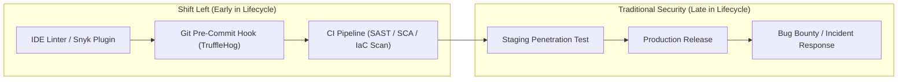

# 01. DevSecOps Philosophy and the Shift-Left Paradigm

[⬅️ Back to Fundamentals](./README.md) | [Next: SDLC vs SSDLC ➡️](./02_SDLC_vs_Secure_SDLC_SSDLC.md)

---

### 1. The Historical Conflict: Dev vs Ops vs Sec

Historically, enterprise IT was split into three competing silos:
- **Developers (Dev)**: Measured on **Speed & Feature Delivery**. Their goal: *"Ship code fast."*
- **Operations (Ops)**: Measured on **Uptime & Stability**. Their goal: *"Do not touch production; changes cause outages."*
- **Security (Sec)**: Measured on **Risk & Compliance**. Their goal: *"Stop all deployments until a 200-page audit checklist is approved."*

This created friction, delay, and shadow IT. DevOps bridged Dev and Ops through continuous automated delivery. **DevSecOps** brings Security into this feedback loop as an automated partner rather than an external gatekeeper.

> 💡 **Analogy**: The Automobile Assembly Line:
> - **Legacy Security**: Building the entire automobile from scratch, painting it, and putting it on the showroom floor. Only then does a safety inspector walk in and crash-test it. If the brakes fail, the entire car must be dismantled down to the chassis, costing thousands of dollars and weeks of delay.
> - **DevSecOps (Shift Left)**: Testing each bolt, brake line, and electrical circuit *at the moment it is manufactured* on the assembly line using automated sensors. Flaws are corrected within seconds before the next part is installed.

---

### 2. The Economic Cost of Fixing Vulnerabilities

According to NIST studies, the cost to remediate a software security vulnerability increases exponentially the later it is discovered:

```
[Design / Architecture Phase]      ───► $100
[Coding / IDE / Pre-commit Phase]   ───► $500
[Build / CI Testing Phase]         ───► $1,500
[System Integration / QA Phase]    ───► $5,000
[Production / Post-Release Phase]  ───► $15,000 to $1,000,000+ (Breach, Fines, PR Disaster)
```

---

### 3. What "Shift Left" Actually Means

"Shift Left" means moving security testing as close to the developer's fingertips as possible:



- In the IDE: Flaws are flagged before the code is even saved.
- In the Pull Request: Automated bot comments pinpoint vulnerable lines before code is merged.
- In the Build: Pipelines fail within 3 minutes if critical vulnerabilities are introduced.
