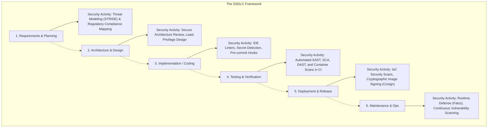

# 02. Software Development Life Cycle (SDLC) vs Secure SDLC (SSDLC)

[⬅️ Prev: DevSecOps Philosophy](./01_DevSecOps_Philosophy_and_Shift_Left.md) | [Back to Fundamentals](./README.md) | [Next: Linux & Scripting ➡️](./03_Linux_and_Shell_Scripting_for_Security.md)

---

### 1. Integrating Security into Every SDLC Phase

A **Secure Software Development Life Cycle (SSDLC)** is a framework that introduces security activities at every step of software creation:

---

### 2. Threat Modeling: The STRIDE Methodology

Before writing code, engineers use Microsoft's **STRIDE** model to predict how an adversary might attack the proposed architecture:

| Threat Category | Property Violated | Example Attack | Defensive Countermeasure |
| :--- | :--- | :--- | :--- |
| **S - Spoofing** | Authentication | Attacker pretends to be a valid user or service. | Mutual TLS (mTLS), FIDO2 MFA, OIDC JWT validation. |
| **T - Tampering** | Integrity | Attacker modifies API requests or database values. | HMAC signatures, input validation, TLS encryption. |
| **R - Repudiation** | Non-repudiation | User denies performing a fraudulent wire transfer. | Tamper-proof append-only audit logging, cryptographic signing. |
| **I - Information Disclosure** | Confidentiality | Database connection string leaked in error response. | Secrets management, masked error messages, encryption at rest. |
| **D - Denial of Service** | Availability | Attacker floods an API with 50,000 requests per second. | Rate limiting, Cloudflare DDoS shielding, auto-scaling. |
| **E - Elevation of Privilege**| Authorization | Regular customer executes administrative API endpoint. | Strict RBAC/ABAC checks at every API route handler. |
