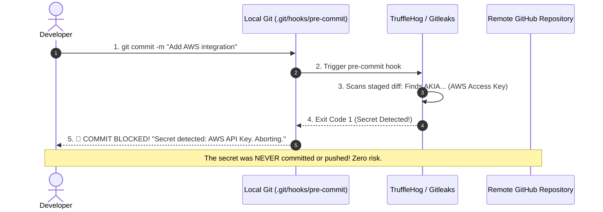

# 04. Git and GitHub Security Workflows

[⬅️ Prev: Linux & Scripting](./03_Linux_and_Shell_Scripting_for_Security.md) | [Back to Fundamentals](./README.md) | [Next: Core Concepts Track ➡️](../02_Core_Concepts/README.md)

---

### 1. Git Architecture for Security Engineers

Git is a distributed version control system. For DevSecOps engineers, Git is not just for tracking code changes—it is the **authoritative control plane for configuration (GitOps)** and the first line of security defense.

---

### 2. Enterprise Branch Protection Rules

Developers should **NEVER** be permitted to push code directly to the `main` or `production` branch.

#### Industry Standard GitHub Branch Protection Ruleset:
1. **Require Pull Request Reviews**: At least 1 (or 2) peer developers must review and approve code.
2. **Require Status Checks to Pass Before Merging**:
   - SAST Scan (Semgrep) must pass.
   - Dependency Vulnerability Scan (Trivy/Snyk) must pass.
   - Secret Leak Detection (TruffleHog) must pass.
   - Unit tests must pass.
3. **Require Signed Commits**: Commits must be cryptographically signed with GPG or SSH keys.
4. **Include Administrators**: Prevent repository administrators from bypassing branch rules.
5. **Dismiss Stale Approvals**: If a developer pushes new commits to an approved PR, previous approvals are automatically revoked until re-reviewed.

---

### 3. Pre-Commit Hooks: Stopping Secrets Before They Leave the Laptop

The most dangerous security incident is when a developer accidentally commits an API key to Git. Even if they delete it in a later commit, the key remains permanently visible in the Git commit history!

**Pre-commit hooks** run scripts locally on the developer's laptop *before* the commit is finalized:

