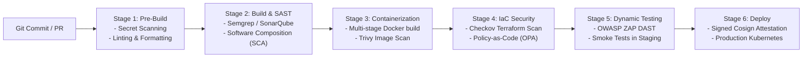

# 01. CI/CD Pipelines and Automated Security Gates

[⬅️ Back to Core Concepts](./README.md) | [Next: AppSec Testing Spectrum ➡️](./02_AppSec_Testing_Spectrum_SAST_DAST_IAST_SCA.md)

---

### 1. Definition and Purpose

A **Continuous Integration and Continuous Delivery (CI/CD)** pipeline is an automated software delivery engine that pulls code from a version control repository, compiles it, executes automated tests, builds container images, and deploys artifacts into cloud environments.

A **Security Gate (or Quality Gate)** is an automated policy check embedded into the pipeline that evaluates the findings of security scanners against predefined threshold criteria:
- If a scanner discovers a `CRITICAL` or `HIGH` vulnerability with an available patch, the gate trips, the pipeline fails, and deployment is halted.
- If only `LOW` or informational findings are discovered, the build passes with a warning.

---

### 2. Modern DevSecOps Pipeline Architecture

---

### 3. Fail-Open vs Fail-Closed Pipelines

| Pipeline Stance | Behavior when Security Scanner Errors Out | Recommended Use Case |
| :--- | :--- | :--- |
| **Fail-Closed (Strict Security)** | If the security scanner crashes, runs out of memory, or API times out, the build FAILS. | High-security, financial, healthcare, and production release branches. |
| **Fail-Open (Developer Velocity)** | If the security scanner errors out, log a warning and let the build proceed. | Early experimental development branches, non-production sandbox testing. |
