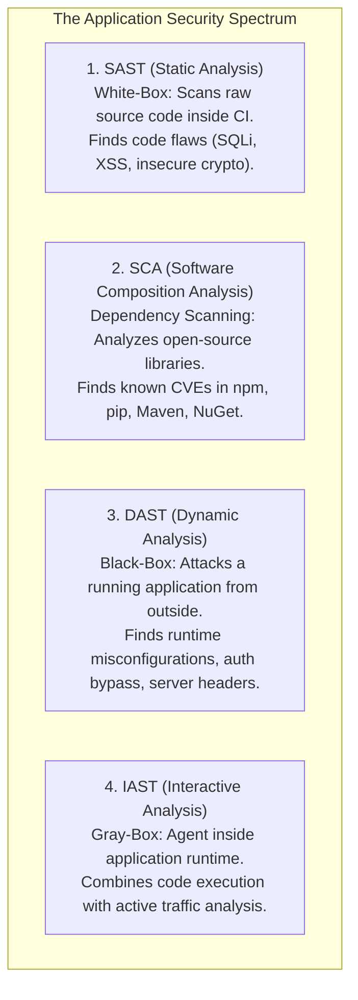

# 02. The AppSec Testing Spectrum: SAST vs DAST vs IAST vs SCA

[⬅️ Prev: CI/CD Pipelines](./01_CI_CD_Pipelines_and_Automated_Gates.md) | [Back to Core Concepts](./README.md) | [Next: Secrets Management ➡️](./03_Secrets_Management_and_Token_Lifecycle.md)

---

### 1. The Four Pillars of Automated Application Security Testing

---

### 2. Comprehensive Comparison Matrix

| Dimension | SAST (Static) | SCA (Dependencies) | DAST (Dynamic) | IAST (Interactive) |
| :--- | :--- | :--- | :--- | :--- |
| **Target Analyzed** | Raw Source Code, AST | Open-source libraries (`package.json`, `pom.xml`) | Running HTTP/HTTPS Web Application | Running App Bytecode / Memory |
| **Knowledge Level** | White-Box (Full access to code) | Manifests & Package Trees | Black-Box (Zero code knowledge) | Gray-Box (Inside running app) |
| **Pipeline Stage** | Code / Build Stage | Code / Build Stage | Staging / Test Deployment | Staging QA / Automated Integration |
| **Execution Speed** | Fast (seconds to minutes) | Very Fast (seconds) | Slow (15–60+ minutes) | Medium (real-time during QA) |
| **Vulnerability Types**| SQL injection, Hardcoded secrets, Buffer overflows | Known CVEs in third-party packages, Licensing issues (GPL) | SQLi, Cross-Site Scripting (XSS), TLS misconfigurations, CORS errors | Real-time taint tracking, exact line-of-code execution flaws |
| **False Positive Rate**| Moderate to High (context unaware) | Low (CVE matches package version) | Low (actual exploit verified) | Very Low |
| **Popular Tools** | Semgrep, SonarQube, Checkmarx | Snyk, Trivy, Dependabot, OWASP Dependency-Check | OWASP ZAP, Burp Suite Enterprise, StackHawk | Contrast Security, Synopsys Seeker |

---

### 3. Concrete Example: What Each Tool Finds on the Same Web App

Imagine a Python Flask application that allows users to search customer accounts:
- **SAST (Semgrep)** inspects `app.py` and flags: `db.execute(f"SELECT * FROM users WHERE name = '{user_input}'")` ➔ **SQL Injection Flaw**.
- **SCA (Trivy/Snyk)** inspects `requirements.txt` and flags: `urllib3==1.26.4` ➔ Vulnerable to **CVE-2021-33503** (ReDoS).
- **DAST (OWASP ZAP)** sends `https://app.local/login?redirect=javascript:alert(1)` ➔ Finds **Reflected Cross-Site Scripting**.
- **IAST (Contrast)** observes the SQL query hitting the live Postgres database and alerts with the exact call stack and query execution plan.
