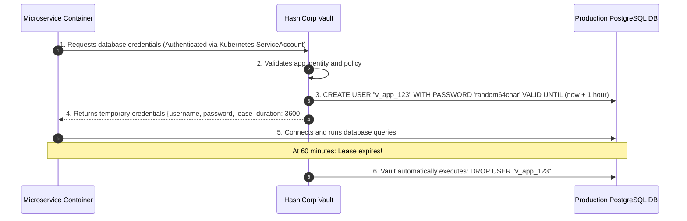

# 03. Secrets Management and Token Lifecycle

[⬅️ Prev: AppSec Testing Spectrum](./02_AppSec_Testing_Spectrum_SAST_DAST_IAST_SCA.md) | [Back to Core Concepts](./README.md) | [Next: Supply Chain Security & SBOM ➡️](./04_Software_Supply_Chain_Security_and_SBOM.md)

---

### 1. Definition and Purpose

A **Secret** is any sensitive digital credential that provides authorization to restricted resources, databases, APIs, or infrastructure (e.g., Database passwords, API keys, SSH private keys, TLS certificates, OAuth client secrets).

**Secrets Sprawl** is one of the most widespread security failures in modern cloud engineering: secrets scattered across Git commits, environment files (`.env`), CI/CD runner logs, Docker image layers, and chat channels.

---

### 2. The Secrets Maturity Model

```
[LEVEL 0 - CATASTROPHIC]
  Secrets hardcoded directly in application source code and pushed to Git.
      │
      ▼
[LEVEL 1 - UNSECURE]
  Secrets stored in unencrypted .env files, config maps, or pasted into CI pipeline environment variables.
      │
      ▼
[LEVEL 2 - MANAGED]
  Secrets encrypted at rest in dedicated cloud vaults (AWS Secrets Manager, Azure Key Vault, HashiCorp Vault).
  Injected at application startup.
      │
      ▼
[LEVEL 3 - ADVANCED / ZERO STANDING PRIVILEGES]
  No static passwords exist anywhere.
  Short-lived dynamic secrets generated on demand (TTL: 1 hour) and rotated automatically.
  Workload Identity Federation (OIDC) replaces long-lived cloud credentials in CI/CD.
```

---

### 3. Dynamic Secrets with HashiCorp Vault

Instead of giving an application a permanent database password, the application requests credentials from HashiCorp Vault:


