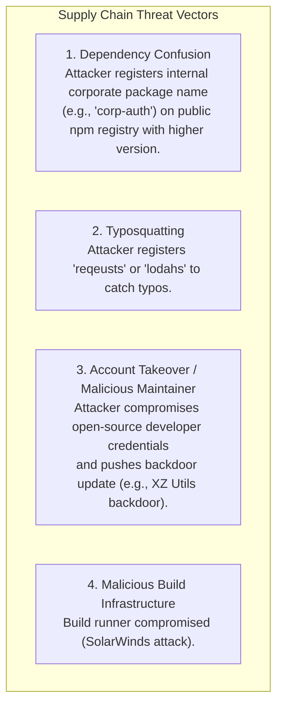

# 04. Software Supply Chain Security and SBOM

[⬅️ Prev: Secrets Management](./03_Secrets_Management_and_Token_Lifecycle.md) | [Back to Core Concepts](./README.md) | [Next: Container Security Basics ➡️](./05_Containerization_and_Docker_Security_Basics.md)

---

### 1. The Anatomy of Modern Software

In modern enterprise applications, **80% to 90% of the deployed code consists of open-source third-party dependencies** (npm packages, Python wheels, Go modules, Java JARs). Proprietary code written by your developers makes up only 10% to 20%.

Attackers know this. Instead of attempting to breach your hardened company firewall, they attack the open-source supply chain that you blindly import.

---

### 2. Software Supply Chain Attack Vectors



---

### 3. What is an SBOM (Software Bill of Materials)?

> 💡 **Analogy**: The Food Nutrition Label:
> When you buy a box of cereal, the FDA requires an ingredients label listing every component, preservative, allergen, and calorie count.
> An **SBOM** is the food ingredient label for your software application.

An **SBOM** is a formal, machine-readable inventory of software components, libraries, versions, and supply chain relationships used to build an application.

#### Major Standard Formats:
- **CycloneDX**: Modern, lightweight, OWASP-backed standard designed specifically for application security and vulnerability scanning.
- **SPDX (Software Package Data Exchange)**: ISO/IEC 5230 international standard focused heavily on software licensing compliance.

#### Generating an SBOM in CI/CD using Syft:
```bash
# Generate CycloneDX JSON SBOM for a Docker container image
syft packages my-app:v1.0.0 -o cyclonedx-json > sbom.json
```
