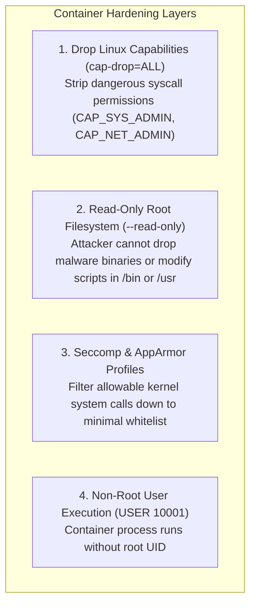

# 01. Container Security and Runtime Hardening

[⬅️ Back to Technologies](./README.md) | [Next: Kubernetes Security ➡️](./02_Kubernetes_Security_Architecture_and_Admission_Control.md)

---

### 1. Hardening the Container Runtime

By default, Docker containers run with extensive Linux capabilities that can be abused for privilege escalation. In production enterprise environments, containers must be strictly constrained:



---

### 2. Hardened Docker Run Flags Example

```bash
docker run -d \
  --name secure-web-app \
  --read-only \
  --tmpfs /tmp:rw,noexec,nosuid,size=64m \
  --cap-drop=ALL \
  --cap-add=NET_BIND_SERVICE \
  --security-opt=no-new-privileges:true \
  --user 10001:10001 \
  -p 8080:8080 \
  my-hardened-app:v1.0.0
```

- `--read-only`: Prevents an attacker who achieves Remote Code Execution (RCE) from writing malicious executables to disk.
- `--cap-drop=ALL`: Strips all 38+ default Linux capabilities.
- `--security-opt=no-new-privileges:true`: Prevents processes from gaining additional privileges via `setuid` binaries.
