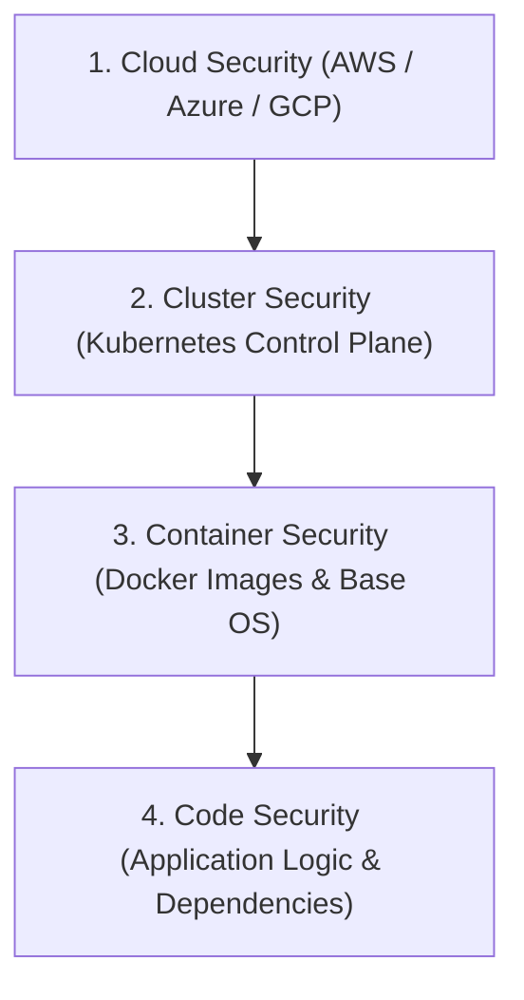
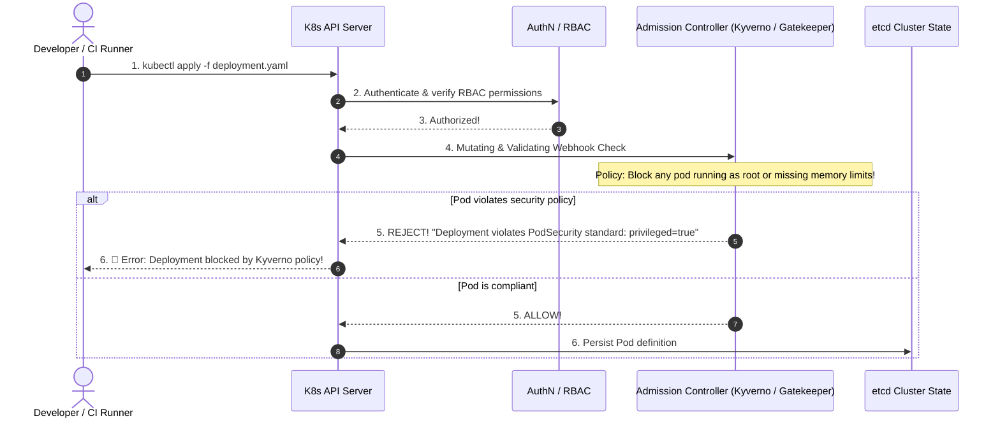

# 02. Kubernetes Security Architecture and Admission Control

[⬅️ Prev: Container Hardening](./01_Container_Security_and_Runtime_Hardening.md) | [Back to Technologies](./README.md) | [Next: Cloud Security & CSPM ➡️](./03_Cloud_Security_Shared_Responsibility_and_CSPM.md)

---

### 1. The 4Cs of Cloud-Native Security

---

### 2. Kubernetes Admission Controllers: The Cluster Gatekeepers

An **Admission Controller** intercepts requests to the Kubernetes API server *after* authentication and authorization, but *before* the object is persisted to `etcd`:

