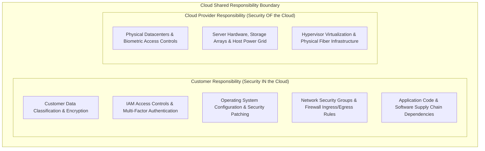

# 03. Cloud Security, Shared Responsibility, and CSPM Deep Dive

[⬅️ Prev: Kubernetes Security](./02_Kubernetes_Security_Architecture_and_Admission_Control.md) | [Back to Technologies](./README.md) | [Next: Zero Trust CI/CD Runners ➡️](./04_Zero_Trust_CI_CD_Runner_Security_and_OIDC.md)

---

### 1. The Cloud Shared Responsibility Model

A critical error beginners make is assuming that moving workloads to Amazon Web Services (AWS), Microsoft Azure, or Google Cloud Platform (GCP) makes infrastructure automatically secure. 

Cloud providers operate under the strict **Shared Responsibility Model**:
- **The Cloud Provider owns Security OF the Cloud**: Physical security of datacenters, environmental controls, biometric facility gates, physical server hardware, storage infrastructure, and hypervisor virtualization.
- **The Enterprise Customer owns Security IN the Cloud**: Customer data encryption, Identity & Access Management (IAM) permissions, operating system patching on IaaS virtual machines, network firewall security groups, and application code.



---

### 2. Service Model Breakdown: IaaS vs PaaS vs SaaS

| Layer | Infrastructure as a Service (IaaS)<br>*(e.g., AWS EC2, Azure VM)* | Platform as a Service (PaaS)<br>*(e.g., AWS RDS, Azure App Service)* | Software as a Service (SaaS)<br>*(e.g., Microsoft 365, Salesforce)* |
| :--- | :--- | :--- | :--- |
| **Data & Access** | Customer Responsibility | Customer Responsibility | Customer Responsibility |
| **Application** | Customer Responsibility | Customer Responsibility | **Cloud Provider** |
| **Operating System** | Customer Responsibility | **Cloud Provider** | **Cloud Provider** |
| **Virtualization** | **Cloud Provider** | **Cloud Provider** | **Cloud Provider** |
| **Physical Hardware**| **Cloud Provider** | **Cloud Provider** | **Cloud Provider** |

---

### 3. What is CSPM (Cloud Security Posture Management)?

**Cloud Security Posture Management (CSPM)** platforms (e.g., Wiz, Palo Alto Prisma Cloud, Microsoft Defender for Cloud, Orca Security) continuously audit multi-cloud accounts via read-only cloud APIs.

Unlike traditional vulnerability scanners that probe network ports from the outside, CSPM connects to the cloud control plane to evaluate configurations against industry security benchmarks:
- **CIS Benchmarks** (Center for Internet Security) for AWS, Azure, and GCP.
- **PCI-DSS, HIPAA, SOC 2 Type II** compliance standards.

#### Critical Misconfigurations CSPM Catches in Real Time:
```text
🚨 CRITICAL: AWS S3 Bucket "customer-invoices" has Public Read ACL enabled (0.0.0.0/0).
🚨 HIGH: Security Group "db-sg" permits inbound MySQL (Port 3306) from any internet IP.
🚨 HIGH: Azure Storage Account has "Secure transfer required (HTTPS)" disabled.
🚨 MEDIUM: AWS IAM Root Account has no Multi-Factor Authentication (MFA) configured.
🚨 MEDIUM: CloudTrail logging is disabled in Region "eu-west-1".
```

---

### 4. CIEM (Cloud Infrastructure Entitlement Management)

In cloud environments, permissions are dangerously complex. AWS IAM alone has over 14,000 distinct API permissions.

**CIEM** analyzes the gap between **Granted Permissions** and **Actually Used Permissions**:
- An engineer's role has `AdministratorAccess` (granting 12,000 permissions).
- Telemetry reveals that over 180 days, the engineer only used `s3:GetObject` and `ec2:DescribeInstances` (2 permissions).
- CIEM automatically generates a least-privilege IAM policy recommendation stripping the 11,998 unneeded permissions, dramatically shrinking the blast radius if the engineer's credentials leak.
