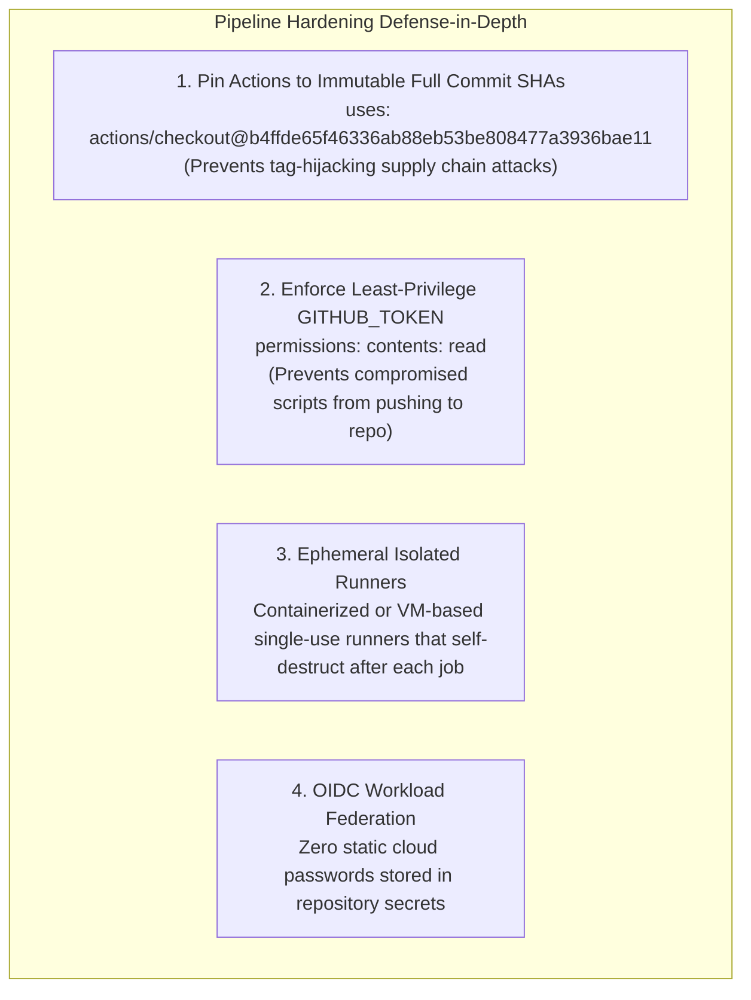

# 01. GitHub Actions and GitLab CI/CD Deep Dive

[⬅️ Back to Tools](./README.md) | [Next: SonarQube & Semgrep SAST ➡️](./02_SonarQube_and_Semgrep_SAST.md)

---

### 1. Platform Overview & Declarative Pipeline Architecture

**GitHub Actions** and **GitLab CI/CD** are the dominant modern cloud and on-premises pipeline automation platforms. They execute automated workflows defined as version-controlled code stored directly inside the repository (`.github/workflows/*.yml` or `.gitlab-ci.yml`).

In a DevSecOps environment, the pipeline is **the security enforcement plane**:
- Every code change triggers automated linters, static code analysis (SAST), software composition analysis (SCA), and secret leak detectors.
- Deployments to cloud environments (AWS, Azure, GCP, Kubernetes) are gated behind cryptographic checks.

---

### 2. Hardening CI/CD Pipelines Against Supply Chain Attacks

A pipeline with elevated administrative privileges is a prime target for attackers. DevSecOps engineers must enforce rigorous pipeline hardening:



---

### 3. Production GitHub Actions Hardened Pipeline Example

```yaml
name: Enterprise Secure Build Pipeline

on:
  push:
    branches: [ "main" ]
  pull_request:
    branches: [ "main" ]

# Enforce minimal default token permissions (Principle of Least Privilege)
permissions:
  contents: read
  security-events: write

concurrency:
  group: ${{ github.workflow }}-${{ github.ref }}
  cancel-in-progress: true

jobs:
  secure-build:
    name: Build & Security Check
    runs-on: ubuntu-latest
    steps:
      # Step 1: Checkout code using pinned full commit SHA (v4.1.1)
      - name: Checkout Repository
        uses: actions/checkout@b4ffde65f46336ab88eb53be808477a3936bae11

      # Step 2: Set up secure runtime environment
      - name: Set up Python
        uses: actions/setup-python@0a5c61591373683505ea898e09a3ea4f39ef2b9c # v5.0.0
        with:
          python-version: '3.11'
          cache: 'pip'

      # Step 3: Secret Detection Gate
      - name: Verify No Leaked Secrets
        run: |
          docker run --rm -v "$PWD:/src" zricethezav/gitleaks:latest detect --source="/src" --verbose --redact

      # Step 4: SAST Scan with Semgrep
      - name: Semgrep Static Code Scan
        run: |
          docker run --rm -v "$PWD:/src" returntocorp/semgrep semgrep scan --config auto --error
```
