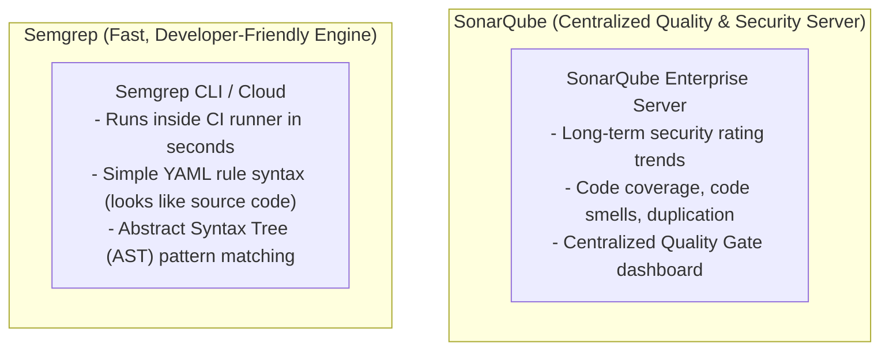

# 02. SonarQube and Semgrep: Static Application Security Testing (SAST) Deep Dive

[⬅️ Prev: GitHub Actions](./01_GitHub_Actions_and_GitLab_CI.md) | [Back to Tools](./README.md) | [Next: Snyk & Trivy SCA ➡️](./03_Snyk_and_Trivy_SCA_and_Vulnerability_Scanning.md)

---

### 1. Platform Comparison: Heavy vs Lightweight SAST

Static Application Security Testing (SAST) analyzes source code without executing the application to uncover vulnerabilities like SQL injection, cross-site scripting (XSS), insecure deserialization, and hardcoded secrets.



| Dimension | SonarQube | Semgrep |
| :--- | :--- | :--- |
| **Execution Model** | Client/Server (Requires dedicated SonarQube server and DB). | Standalone CLI binary or container running directly on the CI runner. |
| **Primary Strength** | Holistic software quality (code smells, test coverage, technical debt). | Lightning-fast security scanning and custom rule authoring. |
| **Custom Rule Creation**| Complex (Requires writing custom Java plugins). | Trivial (Authoring clean YAML patterns matching source syntax). |
| **Speed** | Moderate to Slow (5 to 30+ minutes for large codebases). | Ultra-Fast (Seconds to a couple minutes). |

---

### 2. Semgrep Rule Mechanics & AST Pattern Matching

Unlike regular expressions (regex) which fail when code is split across multiple lines or uses variable aliases, Semgrep parses code into an **Abstract Syntax Tree (AST)**:

```yaml
rules:
  - id: python-flask-raw-sql-injection
    languages: [python]
    severity: ERROR
    message: "Untrusted variable concatenated into raw SQL execute statement!"
    metadata:
      cwe: "CWE-89: SQL Injection"
      owasp: "A03:2021 - Injection"
    patterns:
      - pattern-either:
          - pattern: $DB.execute(f"... {$VAR} ...")
          - pattern: $DB.execute("..." % $VAR)
          - pattern: $DB.execute("..." + $VAR)
      - pattern-not: $DB.execute("...", (...,)) # Ignores safe parameterized queries
```

---

### 3. Running Semgrep in GitHub Actions with SARIF Output

```yaml
- name: Run Semgrep Security Scan
  run: |
    semgrep scan \
      --config "p/owasp-top-ten" \
      --config "p/security-code-review" \
      --error \
      --sarif --output semgrep.sarif

- name: Upload Scan Results to GitHub Security Tab
  uses: github/codeql-action/upload-sarif@v3
  if: always()
  with:
    sarif_file: semgrep.sarif
```
