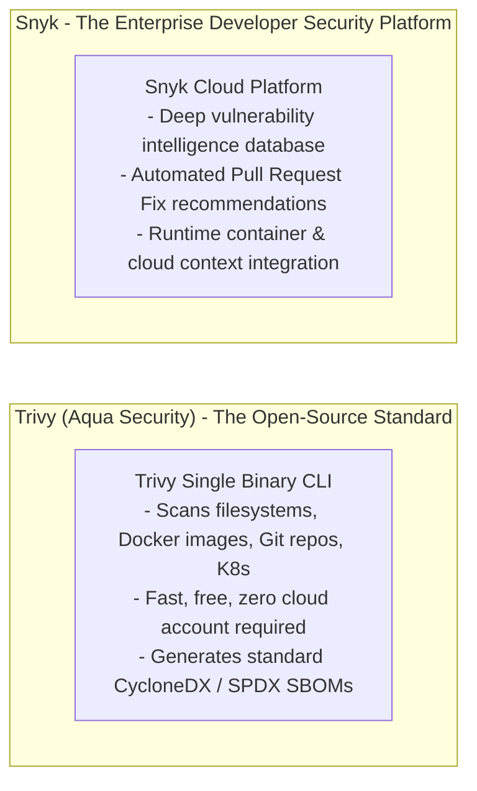

# 03. Snyk and Trivy: Software Composition Analysis (SCA) Deep Dive

[⬅️ Prev: SonarQube & Semgrep](./02_SonarQube_and_Semgrep_SAST.md) | [Back to Tools](./README.md) | [Next: Checkov & Tfsec IaC ➡️](./04_Checkov_and_Tfsec_IaC_Scanning.md)

---

### 1. Platform Overview & The Role of SCA

Over 85% of modern application code is assembled from third-party open-source libraries (npm packages, Python PyPI wheels, Java Maven JARs, Go modules). 

**Software Composition Analysis (SCA)** is the automated discipline of parsing dependency manifests and lockfiles to discover known **Common Vulnerabilities and Exposures (CVEs)** and legal licensing violations (e.g., GPL-3.0 copyleft licenses) in open-source components.

---

### 2. Platform Comparison: Trivy vs Snyk



| Dimension | Trivy (Aqua Security) | Snyk |
| :--- | :--- | :--- |
| **Deployment Model** | Lightweight single binary CLI; 100% local or CI execution. | Cloud-native SaaS platform with CLI and IDE plugins. |
| **Cost** | 100% Free Open-Source (Apache 2.0). | Freemium (Commercial enterprise subscription for scale). |
| **Automated PR Remediation**| Generates SARIF/JSON reports; relies on bots (Dependabot). | Natively opens automated 1-click Pull Requests bumping package versions. |
| **Scanning Scope** | Container images, filesystems, Git repos, VM images, Kubernetes. | Code (SAST), Open Source (SCA), Containers, Cloud (IaC). |

---

### 3. Trivy CLI Mastery: Essential Commands for Pipelines

```bash
# 1. Scan filesystem for open-source package vulnerabilities (SCA)
trivy fs --scanners vuln --severity HIGH,CRITICAL .

# 2. Scan container image, ignoring vulnerabilities that have no vendor fix available
trivy image --severity CRITICAL --ignore-unfixed my-app:latest

# 3. Generate a complete CycloneDX JSON Software Bill of Materials (SBOM)
trivy image --format cyclonedx --output sbom.json my-app:latest

# 4. Strict CI/CD Gate: Fail build (exit code 1) ONLY on Critical fixable vulnerabilities
trivy fs --exit-code 1 --severity CRITICAL --ignore-unfixed .
```

---

### 4. Snyk CLI & Automated Pull Request Fixes

When Snyk detects a vulnerable package in a repository:
```bash
# Authenticate CLI
snyk auth

# Test project dependencies locally
snyk test

# Automatically generate a Pull Request bumping vulnerable dependencies to secure versions
snyk fix
```

**Snyk Dependency Upgrade Recommendation Output**:
```text
Upgrade lodash@4.17.15 to lodash@4.17.21 to fix:
  - Prototype Pollution [High Severity] (CVE-2020-8203)
  - Regular Expression Denial of Service (ReDoS) [Medium Severity] (CVE-2020-28500)
```
