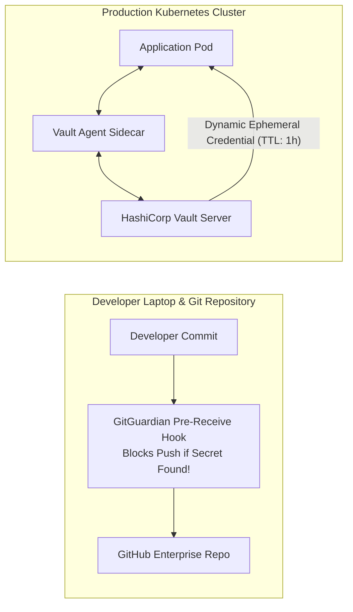

# 05. HashiCorp Vault and GitGuardian Secrets Management Deep Dive

[⬅️ Prev: Checkov & Tfsec](./04_Checkov_and_Tfsec_IaC_Scanning.md) | [Back to Tools](./README.md) | [Next: OWASP ZAP DAST ➡️](./06_OWASP_ZAP_for_DAST.md)

---

### 1. Platform Overview & Defense-in-Depth for Secrets

Secrets management requires two complementary operational pillars:
1. **Preventing Leaks (Detection)**: **GitGuardian** scans commits, pull requests, and public/private repositories in real time to catch accidentally committed API keys, tokens, and private keys.
2. **Centralized Vaulting (Lifecycle)**: **HashiCorp Vault** eliminates static secrets entirely by injecting ephemeral, auto-rotating dynamic credentials directly into application runtimes.



---

### 2. Real-Time Pre-Receive Gating with GitGuardian

By installing GitGuardian as a server-side pre-receive hook in GitHub Enterprise:
- Every `git push` is inspected *before* the remote repository accepts the commit.
- If a developer commits an unencrypted Slack webhook, SendGrid key, or AWS credential, the push is rejected with an error message in their terminal.

---

### 3. Vault Agent Sidecar Injector in Kubernetes

Instead of configuring applications to talk to the Vault API directly, the **Vault Agent Sidecar Injector** mutates the Kubernetes Pod:
```yaml
apiVersion: apps/v1
kind: Deployment
metadata:
  name: billing-service
spec:
  template:
    metadata:
      annotations:
        vault.hashicorp.com/agent-inject: "true"
        vault.hashicorp.com/role: "billing-app-role"
        vault.hashicorp.com/agent-inject-secret-database: "database/creds/billing-db-role"
        vault.hashicorp.com/agent-inject-template-database: |
          {{- with secret "database/creds/billing-db-role" -}}
          DATABASE_USER={{ .Data.username }}
          DATABASE_PASS={{ .Data.password }}
          {{- end -}}
    spec:
      containers:
        - name: app
          image: my-app:latest
```
Vault automatically creates an in-memory volume at `/vault/secrets/database` containing the fresh temporary credentials, renewing them before expiration!
