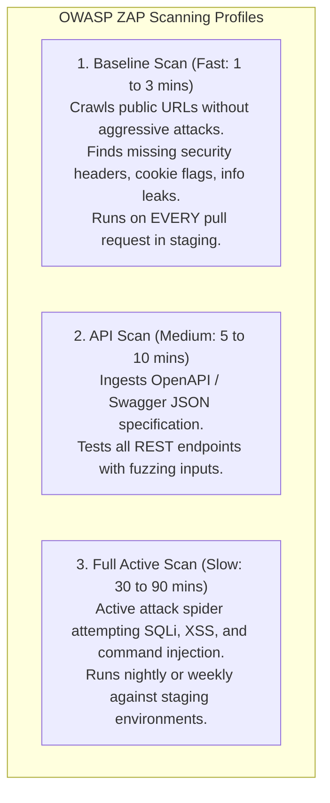

# 06. OWASP ZAP (Zed Attack Proxy) for Automated DAST Deep Dive

[⬅️ Prev: Secrets Tools](./05_HashiCorp_Vault_and_GitGuardian_Secrets.md) | [Back to Tools](./README.md) | [Next: Workflows Track ➡️](../05_Workflows_and_Processes/README.md)

---

### 1. Platform Overview & The Role of DAST

**OWASP ZAP (Zed Attack Proxy)** is the world's most widely used open-source web application vulnerability scanner.

While SAST analyzes uncompiled code, **DAST (Dynamic Application Security Testing)** attacks a deployed, running web service over HTTP/HTTPS from the outside:
- It discovers runtime configuration errors (missing HTTP security headers, permissive CORS policies, cookie flags).
- It tests authentication and input parameters for Cross-Site Scripting (XSS), SQLi, and path traversal without needing source code access.

---

### 2. Automated DAST Scan Types in CI/CD



---

### 3. Executing ZAP Baseline Scan via Docker in GitHub Actions

```yaml
name: Dynamic Application Security Testing (DAST)

on:
  deployment_status:

jobs:
  zap_scan:
    name: OWASP ZAP Baseline DAST
    runs-on: ubuntu-latest
    if: github.event.deployment_status.state == 'success'
    steps:
      - name: Checkout Code
        uses: actions/checkout@v4

      - name: Run OWASP ZAP Baseline Docker Container
        run: |
          docker run --rm -v $(pwd):/zap/wrk/:rw \
            ghcr.io/zaproxy/zaproxy:stable zap-baseline.py \
            -t "https://staging.company.com" \
            -r zap-report.html \
            -J zap-report.json \
            -I # Return warning instead of failing on minor alerts

      - name: Archive ZAP HTML Report
        uses: actions/upload-artifact@v4
        with:
          name: zap-dast-report
          path: zap-report.html
```
