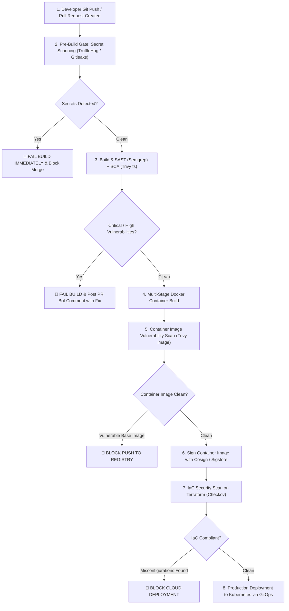

# 01. End-to-End DevSecOps CI/CD Pipeline Workflow SOP

[⬅️ Back to Workflows](./README.md) | [Next: PR Security Checks ➡️](./02_Developer_Pre_Commit_and_PR_Security_Check.md)

---

### 1. Workflow Architecture Diagram

---

### 2. Standard 8-Point Operational Breakdown

#### 1. Trigger
- A developer opens a Pull Request (PR) or merges code into the `main` branch of an enterprise Git repository.

#### 2. Responsible Parties (RACI Matrix)
- **Accountable**: DevSecOps Platform Lead.
- **Responsible**: CI/CD Runner Automation, Software Developer.
- **Consulted**: Application Security Engineer.
- **Informed**: Engineering Team Lead.

#### 3. Required Tools & Information
- **Tools**: GitHub Actions / GitLab CI, TruffleHog (Secrets), Semgrep (SAST), Trivy (SCA/Container), Checkov (IaC), Cosign (Signing), Kubernetes.
- **Inputs**: Source code, Dockerfile, dependency lockfiles (`package-lock.json`), Terraform files (`.tf`).

#### 4. Step-by-Step Execution Procedure
1. **Pre-Build Secret Scan (Duration: ~15 seconds)**:
   - Runner executes TruffleHog against git history of the PR commit range.
2. **SAST & Dependency Analysis (Duration: ~60 seconds)**:
   - Semgrep scans application source code using customized OWASP Top 10 rules.
   - Trivy parses package manifests to detect open-source CVEs.
3. **Containerization & Image Security (Duration: ~90 seconds)**:
   - Build hardened Docker image using multi-stage build.
   - Trivy scans the compiled container image filesystem and OS packages.
4. **Cryptographic Attestation & Signing**:
   - Cosign generates a cryptographic signature using the runner's ephemeral OIDC token and writes the signature to the container registry.
5. **Infrastructure as Code (IaC) Scan (Duration: ~30 seconds)**:
   - Checkov evaluates Terraform templates for cloud security violations (public buckets, unencrypted disks).
6. **Deployment & Runtime Promotion**:
   - Kubernetes cluster admission controller verifies the Cosign signature before allowing pods to spin up in production.

#### 5. Decision Points & Logic Gates
- **IF** any `CRITICAL` or `HIGH` severity vulnerability with a vendor-provided fix is detected, **THEN** exit pipeline with `exit 1` and block PR merge.
- **IF** a vulnerability is `MEDIUM` or `LOW`, **THEN** output a warning annotation, create a tracking ticket, and permit build.

#### 6. Escalation Matrix
- **Disputed False Positive Blocking Production Release**: Escalate to Application Security Engineer on-call (SLA: 30 minutes).

#### 7. Expected Outcome
- Only verified, scanned, non-vulnerable, and cryptographically signed artifacts are deployed to production infrastructure with zero human manual intervention.

#### 8. Documentation & Audit Evidence
- GitHub Security Tab SARIF reports, pipeline execution logs, CycloneDX SBOM artifact, and signed Cosign attestation stored in container registry.
