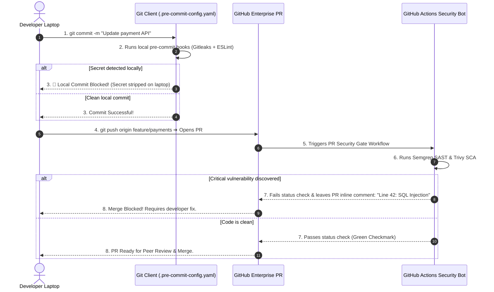

# 02. Developer Pre-Commit and Pull Request Security Check SOP

[⬅️ Prev: End-to-End Pipeline](./01_End_to_End_DevSecOps_Pipeline_Workflow.md) | [Back to Workflows](./README.md) | [Next: Security Gate Criteria ➡️](./03_Automated_Security_Gate_Pass_Fail_Criteria.md)

---

### 1. Workflow Architecture Diagram

---

### 2. Standard 8-Point Operational Breakdown

#### 1. Trigger
- A developer attempts to execute a `git commit` locally on their workstation, or opens/updates a Pull Request on GitHub.

#### 2. Responsible Parties (RACI Matrix)
- **Accountable**: Application Security Engineering Lead.
- **Responsible**: Individual Software Developer.
- **Consulted**: DevSecOps Engineer.
- **Informed**: Peer Code Reviewers.

#### 3. Required Tools & Information
- **Tools**: `pre-commit` framework (Python), Gitleaks, Semgrep, GitHub PR Comments Bot.
- **Inputs**: Staged Git changes (`git diff --cached`).

#### 4. Step-by-Step Execution Procedure
1. **Pre-Commit Hook Execution**:
   - Developer types `git commit`. The pre-commit framework automatically intercepts the command and executes Gitleaks locally against staged files.
2. **PR Automated Scanning**:
   - Upon push, GitHub Actions spins up an ephemeral runner.
   - Runs `semgrep scan --config auto --sarif --output semgrep.sarif`.
3. **Automated PR Annotation**:
   - Action uploads `semgrep.sarif` to GitHub Code Scanning API.
   - GitHub decorates the PR diff with inline annotations on the exact line of vulnerable code, showing remediation examples.
4. **Enforcing Branch Protection**:
   - The PR merge button remains grayed out and disabled until all required security checks report green `SUCCESS`.

#### 5. Decision Points & Logic Gates
- **IF** pre-commit hook detects a secret, **THEN** commit is aborted; developer must remove the credential.
- **IF** developer attempts to bypass hooks via `git commit --no-verify`, **THEN** the server-side PR workflow catches and blocks the change on GitHub regardless.

#### 6. Escalation Matrix
- **Security Scanner Crash / Infrastructure Blocker**: Escalate to DevSecOps Platform Support (SLA: 1 hour).

#### 7. Expected Outcome
- Vulnerabilities and secrets are detected and resolved at the earliest possible moment without ever entering the shared repository code history.

#### 8. Documentation & Audit Evidence
- GitHub Pull Request status checks history, SARIF code scanning uploads, and branch protection enforcement audit logs.
