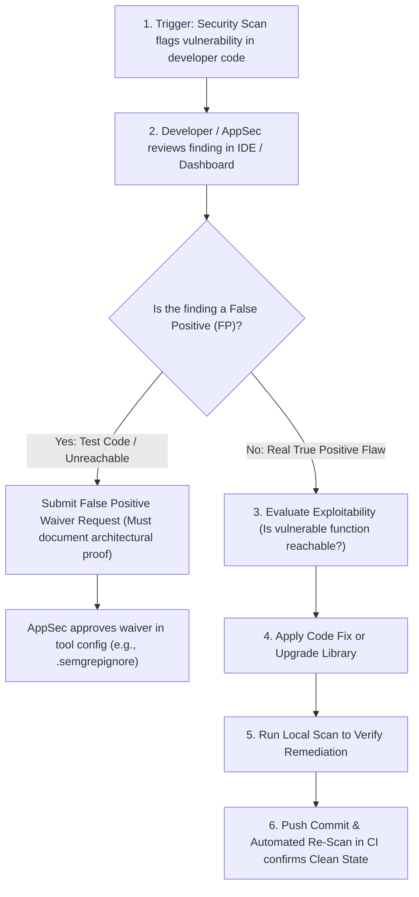

# 04. Vulnerability Triage and Developer Remediation SOP

[⬅️ Prev: Security Gate Criteria](./03_Automated_Security_Gate_Pass_Fail_Criteria.md) | [Back to Workflows](./README.md) | [Next: Dependency Management ➡️](./05_Dependency_Vulnerability_Management_and_Patching.md)

---

### 1. Workflow Architecture Diagram

---

### 2. Standard 8-Point Operational Breakdown

#### 1. Trigger
- A developer's pipeline fails due to a security finding, or a monthly security scanner flags a new CVE in existing production code.

#### 2. Responsible Parties (RACI Matrix)
- **Accountable**: Engineering Team Lead.
- **Responsible**: Assigned Developer (Remediation), AppSec Engineer (Triage guidance).
- **Consulted**: Enterprise Security Architect.
- **Informed**: Product Owner.

#### 3. Required Tools & Information
- **Tools**: Jira Software, GitHub Security Dashboard, Semgrep / Snyk web consoles.
- **Inputs**: Vulnerability Title, CVE ID, CVSS score, file path, line number, call graph trace.

#### 4. Step-by-Step Execution Procedure
1. **Initial Assessment**: Developer reads scanner remediation advice and code snippet.
2. **Reachability Analysis**:
   - *Is the vulnerable library function actually called by our application, or is it dead code?*
3. **Remediation Execution**:
   - For Code Flaws (SAST): Refactor code to use parameterized queries (prepared statements) or safe APIs.
   - For Dependency Flaws (SCA): Bump package version in `package.json` / `requirements.txt`.
4. **Local Verification**:
   - Run scanner locally to confirm finding disappears.
5. **Git Push & Ticket Closure**:
   - Developer merges PR; Jira ticket automatically transitions to `Resolved`.

#### 5. Decision Points & Logic Gates
- **IF** updating a dependency breaks major backwards compatibility, **THEN** investigate container-level or WAF compensatory mitigation until refactoring is scheduled.
- **IF** developer claims false positive, **THEN** require peer AppSec sign-off before suppressing rule.

#### 6. Escalation Matrix
- **Remediation SLA Breached (> 7 days for High)**: Automated ticket escalation to Engineering Director.

#### 7. Expected Outcome
- Vulnerabilities are remediated directly within regular engineering sprints without accumulating technical security debt.

#### 8. Documentation & Audit Evidence
- Jira remediation ticket linked to GitHub PR commit SHA and closed verification scan results.
