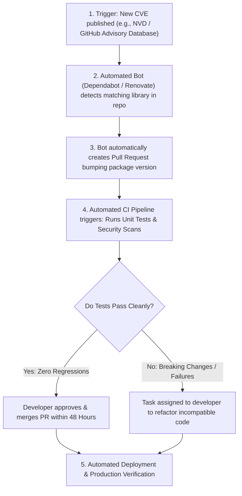

# 05. Dependency Vulnerability Management and Patching SOP

[⬅️ Prev: Vulnerability Triage](./04_Vulnerability_Triage_and_Developer_Remediation.md) | [Back to Workflows](./README.md) | [Next: Production Runtime Loop ➡️](./06_Production_Runtime_Monitoring_and_Feedback_Loop.md)

---

### 1. Workflow Architecture Diagram

---

### 2. Standard 8-Point Operational Breakdown

#### 1. Trigger
- National Vulnerability Database (NVD) publishes a new CVE affecting an open-source library used in enterprise codebases.

#### 2. Responsible Parties (RACI Matrix)
- **Accountable**: Head of DevOps & Platform Architecture.
- **Responsible**: Automated Dependency Bot (Dependabot/Renovate), Development Squad.
- **Consulted**: Application Security Lead.
- **Informed**: Release Manager.

#### 3. Required Tools & Information
- **Tools**: GitHub Dependabot / Renovate Bot, Snyk, Maven / npm / pip CLI.
- **Inputs**: CVE details, CVSS vector, recommended patched version string.

#### 4. Step-by-Step Execution Procedure
1. **Automated Discovery**: Dependency bot scans repository lockfiles and identifies vulnerable dependency.
2. **Automated PR Generation**:
   - Bot opens a Pull Request with title: *"Bump lodash from 4.17.19 to 4.17.21"*.
   - Includes release notes, changelog diff, and compatibility score.
3. **Automated Regression Testing**:
   - Pipeline runs full regression test suite in CI.
4. **Developer Review & Merge**:
   - Developer reviews test results and merges PR.

#### 5. Decision Points & Logic Gates
- **IF** the CVE is classified as an active Zero-Day (e.g., Log4Shell), **THEN** invoke the **Emergency Out-of-Band Patching Protocol** (Deploy within 6 hours).
- **IF** the update is a minor non-breaking patch, **THEN** enable automated auto-merge.

#### 6. Escalation Matrix
- **Critical CVE Unpatched after 48 Hours**: Alert escalated to VP of Engineering.

#### 7. Expected Outcome
- Enterprise applications remain continuously patched against known open-source vulnerabilities with minimal manual maintenance.

#### 8. Documentation & Audit Evidence
- Dependabot PR audit log, CI test completion timestamps, and updated Software Bill of Materials (SBOM).
