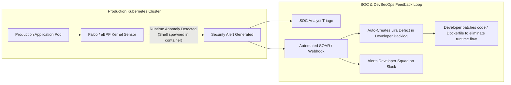

# 06. Production Runtime Monitoring and Feedback Loop SOP

[⬅️ Prev: Dependency Management](./05_Dependency_Vulnerability_Management_and_Patching.md) | [Back to Workflows](./README.md) | [Next: Real-World Scenarios Track ➡️](../06_Real_World_Scenarios/README.md)

---

### 1. Workflow Architecture Diagram

---

### 2. Standard 8-Point Operational Breakdown

#### 1. Trigger
- A runtime security detection tool (e.g., Falco, Sysdig, Prisma Cloud) detects an abnormal or unauthorized system event inside a production container (e.g., a web application spawns `/bin/bash` or writes to `/etc`).

#### 2. Responsible Parties (RACI Matrix)
- **Accountable**: CISO & Cloud Infrastructure Director.
- **Responsible**: SOC Analyst (Immediate containment), DevSecOps Engineer (Root cause fix).
- **Consulted**: Application Developer.
- **Informed**: Product Lead.

#### 3. Required Tools & Information
- **Tools**: Falco (eBPF), Kubernetes API, Microsoft Sentinel / Splunk, Jira Software.
- **Inputs**: Pod Name, Container ID, Namespace, System Call / Process Name, Node IP.

#### 4. Step-by-Step Execution Procedure
1. **Real-Time Detection**: Falco rule triggers:
   `Rule: Terminal shell in container | Output: Shell spawned in pod payment-service-7d8b (user=root process=bash)`
2. **Automated SOC & DevSecOps Alert**: Webhook dispatches alert to SIEM and development channel.
3. **Immediate Containment**: SOC or automated playbook isolates pod by modifying Kubernetes network policy.
4. **Feedback Loop to Developers**:
   - The root cause (e.g., an unhandled RCE vulnerability in the web code) is logged as a P1 Bug in the developer's Jira backlog.
5. **Permanent Fix**:
   - Developers fix the input validation flaw in code.
   - DevSecOps engineers enforce `--read-only` root filesystem on the pod manifest to prevent shell execution.

#### 5. Decision Points & Logic Gates
- **IF** the shell was spawned by an authorized on-call engineer debugging an outage, **THEN** confirm change ticket and document session.
- **IF** unauthorized, **THEN** declare an immediate active security intrusion.

#### 6. Escalation Matrix
- **Confirmed Remote Code Execution in Production**: Escalate to Incident Response Commander.

#### 7. Expected Outcome
- Closing the loop between production runtime security and software development, ensuring production incidents permanently improve code and infrastructure defenses.

#### 8. Documentation & Audit Evidence
- Falco alert payload, Kubernetes pod audit logs, and Jira root-cause remediation ticket.
