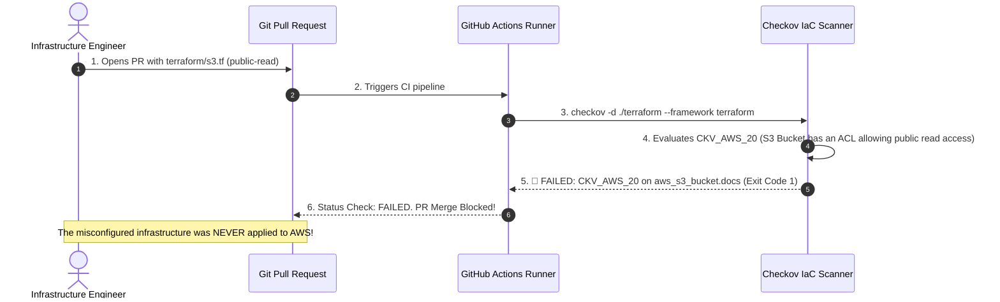

# Case Study 04: Overprivileged Terraform S3 Bucket Misconfiguration

[⬅️ Prev: Malicious Docker Image](./03_Scenario_Malicious_Docker_Base_Image_Supply_Chain.md) | [Back to Scenarios](./README.md) | [Next: Hands-On Labs Track ➡️](../07_Hands_On_Labs/README.md)

---

### 1. The Incident Context
An infrastructure developer authored a Terraform module to host static documentation. They inadvertently set `acl = "public-read"` on an S3 bucket that was later used by an automated script to store unencrypted database backups containing 450,000 customer Social Security Numbers.

### 2. How DevSecOps Catches This with Checkov in CI/CD



### 3. The Remediated Terraform Code:
```hcl
resource "aws_s3_bucket" "docs" {
  bucket = "company-internal-docs-bucket"
}

# Enforce strict public access block
resource "aws_s3_bucket_public_access_block" "block_public" {
  bucket = aws_s3_bucket.docs.id

  block_public_acls       = true
  block_public_policy     = true
  ignore_public_acls      = true
  restrict_public_buckets = true
}

# Enforce KMS Server-Side Encryption
resource "aws_s3_bucket_server_side_encryption_configuration" "encryption" {
  bucket = aws_s3_bucket.docs.id

  rule {
    apply_server_side_encryption_by_default {
      sse_algorithm = "aws:kms"
    }
  }
}
```
