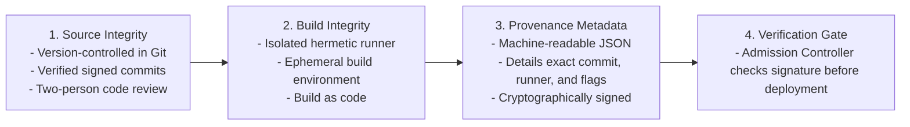

# 01. The SLSA Framework and Cryptographic Attestation Signing Deep Dive

[⬅️ Back to Advanced Topics](./README.md) | [Next: Policy-as-Code ➡️](./02_Policy_as_Code_with_OPA_and_Kyverno.md)

---

### 1. What is SLSA (Supply-chain Levels for Software Artifacts)?

**SLSA** (pronounced *"salsa"*) is an open-source security framework developed by Google and the OpenSSF (Open Source Security Foundation). It provides a standardized specification to prevent tampering, ensure software integrity, and secure packages from source code to production deployment.



---

### 2. The Four SLSA Levels Explained

| SLSA Level | Requirements | Security Benefit |
| :--- | :--- | :--- |
| **SLSA 1** | Automated build script; provenance metadata generated. | Basic tracking: Proves *what* built the artifact. |
| **SLSA 2** | Version control enforced; hosted build service generating signed provenance. | Prevents tampering with provenance after the build. |
| **SLSA 3** | Hermetic, isolated ephemeral build environments; provenance is non-falsifiable. | Guarantees that the build runner cannot be manipulated by outside network calls. |
| **SLSA 4** | Two-person review for all changes; hermetic reproducible builds. | Highest enterprise assurance against sophisticated nation-state insider attacks. |

---

### 3. Keyless Image Signing with Sigstore Cosign

In modern DevSecOps, you should not manage static private GPG keys that can be stolen. **Sigstore Cosign** uses OpenID Connect (OIDC) identities to achieve **Keyless Signing**:

```bash
# 1. Install Cosign CLI
curl -O -L "https://github.com/sigstore/cosign/releases/latest/download/cosign-linux-amd64"
chmod +x cosign-linux-amd64 && sudo mv cosign-linux-amd64 /usr/local/bin/cosign

# 2. Sign a container image inside GitHub Actions using runner OIDC identity
cosign sign --yes ghcr.io/my-org/my-app:v1.0.0

# 3. Verify signature in Kubernetes admission controller or local terminal
cosign verify \
  --certificate-identity "https://github.com/my-org/my-app/.github/workflows/deploy.yml@refs/heads/main" \
  --certificate-oidc-issuer "https://token.actions.githubusercontent.com" \
  ghcr.io/my-org/my-app:v1.0.0
```
