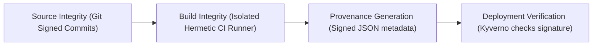

# 01. The SLSA Framework and Cryptographic Attestation Signing

[⬅️ Back to Advanced Topics](./README.md) | [Next: Policy-as-Code ➡️](./02_Policy_as_Code_with_OPA_and_Kyverno.md)

---

### 1. What is SLSA?
**SLSA (Supply-chain Levels for Software Artifacts)** (pronounced *"salsa"*) is a security framework created by Google to prevent tampering, improve software integrity, and secure packages from source code to production deployment.



---

### 2. Cryptographic Signing with Cosign (Sigstore)

In modern DevSecOps, container images are signed in CI/CD without needing to manage long-lived private keys:

```bash
# Keyless signing via GitHub Actions OIDC identity
cosign sign --yes my-registry.com/app:v1.0.0
```
