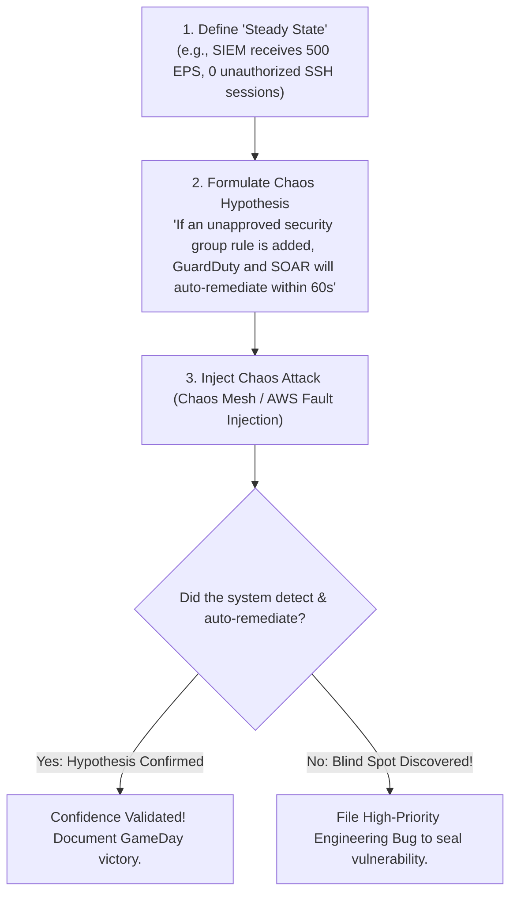

# 03. Security Chaos Engineering and GameDays Deep Dive

[⬅️ Prev: Policy-as-Code](./02_Policy_as_Code_with_OPA_and_Kyverno.md) | [Back to Advanced Topics](./README.md) | [Next: eBPF Security ➡️](./04_eBPF_Security_and_Runtime_Enforcement.md)

---

### 1. Definition and Philosophy

**Security Chaos Engineering** is the discipline of actively experimenting on a distributed software system to build confidence in the system's ability to withstand malicious conditions and security failures in production.

Instead of waiting for an attacker to test your defenses, you proactively inject simulated failures:
- *What happens if our logging agent crashes on 30% of nodes? Does the SIEM alert on missing logs?*
- *What happens if an AWS IAM role session token is suddenly revoked? Does the application crash or fail gracefully?*
- *What happens if TLS certificates expire? Do automated alerts fire 30 days before?*

---

### 2. How to Run an Enterprise Security GameDay

A **Security GameDay** is a 4-hour scheduled exercise where security engineers, cloud architects, and software developers run live failure scenarios in staging:
1. **Blue Team (Defenders)**: Developers & SOC Analysts watching production dashboards.
2. **Red Team (Chaos Invalidator)**: DevSecOps engineer triggering scripted disruptions.
3. **Scenarios Tested**:
   - Simulated secret leak in a PR to test pre-receive hooks.
   - Injecting an unauthorized privileged pod into Kubernetes to verify Kyverno admission controller blocks it.
   - Artificially throttling AWS CloudTrail API calls to observe if SIEM raises an alert on missing logs.
