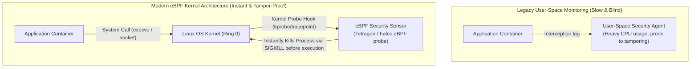

# 04. eBPF Security and Kernel Runtime Enforcement

[⬅️ Prev: Chaos Security](./03_Chaos_Engineering_and_Security_GameDays.md) | [Back to Advanced Topics](./README.md) | [Next: Interview Prep ➡️](../09_Interview_Preparation/README.md)

---

### 1. What is eBPF (Extended Berkeley Packet Filter)?

**eBPF** is a revolutionary Linux kernel technology that allows sandboxed programs to execute directly within the Linux operating system kernel without changing kernel source code or loading dangerous kernel modules.

> 💡 **Analogy**: The High-Speed Security X-Ray Machine:
> - Traditional user-space monitoring tools (like standard antivirus) stand at the exit door of the airport terminal. They must wait for files to be written or network calls to be processed, which slows down the application and can be bypassed if the application crashes.
> - **eBPF** is an ultra-fast microscopic sensor embedded directly inside the airport baggage conveyor belt (the OS Kernel). It inspects every system call, network packet, and memory access in nanoseconds with near-zero performance overhead, capable of stopping a malicious action *before* the kernel finishes executing it.

---

### 2. Traditional Monitoring vs eBPF Runtime Security

---

### 3. Deep Enforcement with Cilium Tetragon

Tools like **Cilium Tetragon** use eBPF to enforce real-time security policies at the kernel level:
- **Zero-Latency Process Killing**: If a compromised container process attempts to read `/etc/shadow` or execute `nsenter` (container breakout), Tetragon's eBPF hook drops a `SIGKILL` in kernel space before the file read syscall completes.
- **Cryptographic Network Identity**: eBPF attaches cryptographic security identities to raw network packets, enforcing zero-trust service-to-service firewalls without heavy sidecar proxies.
