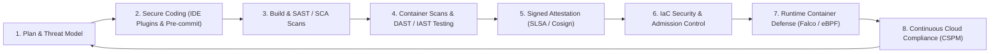

# DevSecOps (Development, Security, and Operations) Career Path & Knowledge Base

Welcome to the **Enterprise DevSecOps Engineer** curriculum. This track equips you to automate security controls directly into the software development lifecycle (SSDLC), secure container infrastructure, govern multi-cloud environments via Infrastructure as Code (IaC), and defend the software supply chain.

---

## 📌 Track Overview

Historically, security was an afterthought—a manual compliance audit performed by an isolated security team days before production release. If security found vulnerabilities, developers had to rewrite weeks of work, causing tension and delays.

**DevSecOps transforms security into code**:
- Security is integrated into every step of the developer workflow (**Shift Left**).
- Automated security testing runs on every Git commit and pull request.
- Infrastructure configurations are tested as code before cloud deployment.
- Security becomes an enabler of speed, safety, and developer velocity.

---

## 🗺️ Chronological Learning Sequence

| Folder | Focus Area | Description |
| :--- | :--- | :--- |
| **[01_Fundamentals](./01_Fundamentals/README.md)** | Baseline Foundations | DevSecOps philosophy, Shift-Left, SSDLC vs SDLC, Bash scripting, and Git workflows. |
| **[02_Core_Concepts](./02_Core_Concepts/README.md)** | AppSec & Delivery | Automated CI/CD gates, SAST, DAST, SCA, IAST, Secrets management, SBOM, and IaC. |
| **[03_Technologies_and_Architectures](./03_Technologies_and_Architectures/README.md)** | Infrastructure Security | Container runtime hardening, Kubernetes security, Admission controllers, Cloud CSPM, and OIDC runner trust. |
| **[04_Tools_and_Platforms](./04_Tools_and_Platforms/README.md)** | DevSecOps Toolchain | GitHub Actions, SonarQube, Semgrep, Snyk, Trivy, Checkov, HashiCorp Vault, OWASP ZAP. |
| **[05_Workflows_and_Processes](./05_Workflows_and_Processes/README.md)** | Enterprise SOPs | 8-point operational workflows for CI/CD Gates, PR Security Checks, Triage & Remediation, and Feedback Loops. |
| **[06_Real_World_Scenarios](./06_Real_World_Scenarios/README.md)** | Breach Case Studies | Leaked AWS keys in Git, Log4j supply chain crisis, malicious Docker images, overprivileged Terraform S3 buckets. |
| **[07_Hands_On_Labs](./07_Hands_On_Labs/README.md)** | Practical Skills | Building secure GitHub Actions pipelines, writing custom Semgrep rules, scanning Docker images with Trivy, Checkov IaC scans. |
| **[08_Advanced_Topics](./08_Advanced_Topics/README.md)** | Next-Gen Security | SLSA supply chain security, Sigstore cosign signing, Policy-as-Code (OPA/Kyverno), and Security Chaos Engineering. |
| **[09_Interview_Preparation](./09_Interview_Preparation/README.md)** | Career Readiness | 40+ technical questions, pipeline architecture design challenges, and hiring manager expectations. |
