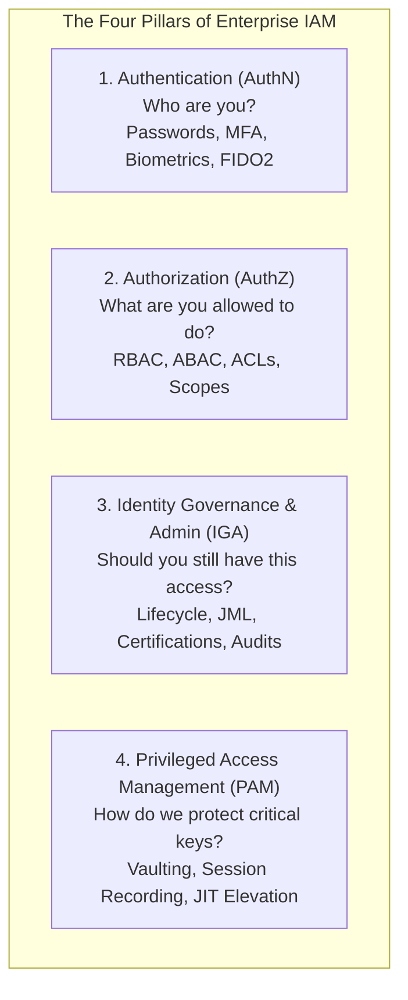

# 01. What is Identity and Access Management (IAM)?

[⬅️ Back to Fundamentals](./README.md) | [Next: Identity vs Account vs Identifier ➡️](./02_Identity_vs_Account_vs_Identifier.md)

---

### 1. Definition and Purpose

**Identity and Access Management (IAM)** is the foundational security discipline, framework, and set of business processes and technologies that ensures **the right individuals and entities access the right corporate resources, at the right time, for the right reasons, via verified mechanisms**.

> 💡 **Analogy**: Think of a modern high-security office skyscraper.
> - The building directory that lists who works for the tenant companies is the **Identity Repository**.
> - The front security desk verifying your government ID and issuing your badge is **Authentication**.
> - The smart elevators that only let you exit on floor 14 (where your team sits) and keep you out of the executive boardroom on floor 30 is **Authorization**.
> - The digital log of every badge swipe that gets audited every quarter is **Identity Governance**.
> Together, this complete system is **IAM**.

Without IAM, organizations face either total paralysis (nobody can access what they need) or total catastrophe (everyone has unrestricted root access to everything).

---

### 2. The Four Pillars of IAM

1. **Authentication (AuthN)**: Verifying the asserted claim of identity.
2. **Authorization (AuthZ)**: Determining permissions and boundary limits after identity is verified.
3. **Identity Governance and Administration (IGA)**: Managing identity lifecycle from hiring to retirement, certifying compliance, and auditing access.
4. **Privileged Access Management (PAM)**: Guarding high-risk accounts (domain admins, cloud root, database superusers) that attackers prioritize.

---

### 3. Why Enterprise Organizations Need IAM

In a modern enterprise with 10,000 employees, 200 SaaS applications, multiple AWS/Azure cloud environments, and thousands of contractors:

- **Security Perimeter Enforcement**: 80%+ of breaches involve compromised credentials or privilege misuse. IAM stops initial lateral movement.
- **Regulatory Compliance**: Regulations such as SOX, HIPAA, PCI-DSS, and GDPR mandate strict access controls, separation of duties (SoD), and quarterly access reviews.
- **Operational Efficiency**: Automated onboarding means a new engineer can deploy code on Day 1 rather than waiting 3 weeks for manual ticket approvals.
- **Cost Reduction**: Automated deprovisioning immediately reclaims costly SaaS licenses when employees depart.

---

### 4. What an IAM Professional Actually Does

A career in IAM is not about manually resetting passwords. An IAM Engineer:
- **Architects Federated Trust**: Configures SSO connections between cloud IdPs (Okta/Entra ID) and applications using SAML 2.0 and OIDC.
- **Designs Role Models**: Collaborates with business leaders to build Role-Based Access Control (RBAC) matrices.
- **Automates Identity Pipelines**: Writes SCIM connectors, PowerShell/Python automation, and SailPoint rules to provision accounts instantly when HR records update.
- **Enforces Zero Trust Policies**: Builds risk-based Conditional Access policies requiring step-up MFA if a login originates from an untrusted country.
- **Audits and Remediates**: Investigates over-privileged accounts, dormant service principals, and toxic permission combinations.

---

### 5. Common Misconceptions

| Myth | Reality |
| :--- | :--- |
| *"IAM is just the IT Helpdesk resetting passwords."* | Helpdesk is first-line support. IAM engineers build the automated, zero-trust architectures, protocol integrations, and governance engines that eliminate manual resets entirely. |
| *"Once an employee gets access, our job is done."* | The biggest risk is "privilege creep"—employees changing roles over 5 years and accumulating dangerous combinations of permissions that never get revoked. |
| *"MFA makes passwords completely safe."* | Basic SMS/push MFA is vulnerable to SIM-swapping and MFA fatigue (push bombing). Modern IAM requires phishing-resistant FIDO2/WebAuthn. |

---

### 6. Best Practices

- Always treat the **HR system as the Authoritative Source of Truth** for workforce identities.
- Apply the **Principle of Least Privilege (PoLP)** across all accounts and applications.
- Enforce **Separation of Duties (SoD)**—the person requesting access cannot be the sole approver.
- Eliminate static administrative passwords in favor of **Just-In-Time (JIT)** ephemeral elevation.
