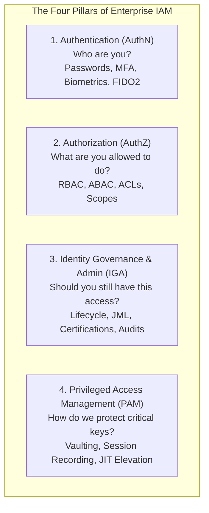

# 01. What is Identity and Access Management (IAM)?

[⬅️ Prev: Beginner's Glossary](./00_IAM_Beginners_Glossary_and_Acronym_Decoder.md) | [Back to Fundamentals](./README.md) | [Next: Identity vs Account ➡️](./02_Identity_vs_Account_vs_Identifier.md)

---

### 🎓 Beginner's Compass: Decoded Terms in This File
Before reading, familiarize yourself with these essential terms (see [Glossary](./00_IAM_Beginners_Glossary_and_Acronym_Decoder.md) for full details):
- **IAM (Identity & Access Management)**: The complete framework ensuring only authorized people access company systems.
- **AuthN (Authentication)**: *"Who are you?"* (Verifying your identity).
- **AuthZ (Authorization)**: *"What are you allowed to touch?"* (Checking your permissions).
- **IdP (Identity Provider)**: The central server (like Microsoft Entra ID or Okta) that stores your credentials.
- **SaaS (Software-as-a-Service)**: Cloud software you use in a browser (like Slack, Salesforce, Zoom, Google Workspace).
- **JML (Joiner, Mover, Leaver)**: The business process of hiring, transferring, and terminating employees.
- **PoLP (Principle of Least Privilege)**: Giving users only the bare minimum access needed to do their current job.

---

### 1. Definition and Purpose

**Identity and Access Management (IAM)** is the foundational security discipline, business framework, and collection of software tools that ensures **the right individuals and entities access the right corporate resources, at the right time, for the right reasons, via verified mechanisms**.

> 💡 **Analogy**: The Modern High-Security Skyscraper
> Imagine a 50-story corporate headquarters:
> - The HR directory listing all legal employees of tenant companies is the **Authoritative Source (Identity Repository)**.
> - The front security desk verifying your government driver's license and issuing your RFID badge is **Authentication (AuthN)**.
> - The smart elevators that allow your badge to open floor 14 (Engineering) but buzz with a red light if you try to visit floor 40 (Executive Boardroom) is **Authorization (AuthZ)**.
> - The security supervisor who audits badge swipe history every quarter to make sure ex-contractors don't still have building access is **Identity Governance (IGA)**.
> - The armored vault holding master keys to the electrical transformer room that requires two security officers and a CCTV camera is **Privileged Access Management (PAM)**.
> **Together, this complete security ecosystem is IAM.**

Without IAM, organizations face either total paralysis (nobody can access what they need) or total catastrophe (everyone has unrestricted root access to everything).

---

### 2. The Four Pillars of IAM

1. **Authentication (AuthN)**: Verifying the asserted claim of identity. *"Prove that you are truly Alice Smith."*
2. **Authorization (AuthZ)**: Determining permissions and boundary limits after identity is verified. *"Alice is authenticated, but is she allowed to delete the customer billing database? No."*
3. **Identity Governance and Administration (IGA)**: Managing identity lifecycle from hiring to retirement, certifying compliance, and auditing access. *"Bob moved from Sales to IT 6 months ago. Why does he still have access to the Sales commission spreadsheets? Revoke it."*
4. **Privileged Access Management (PAM)**: Guarding high-risk accounts (domain admins, cloud root, database superusers) that attackers prioritize. *"Nobody gets permanent root passwords; you check out temporary access with ticket approval."*

---

### 3. Why Enterprise Organizations Need IAM

In a modern enterprise with 10,000 employees, 200 SaaS applications, multiple AWS/Azure cloud environments, and thousands of contractors:

- **Security Perimeter Enforcement**: 80%+ of security breaches involve stolen passwords or credential misuse. IAM acts as the primary gate that prevents initial unauthorized entry.
- **Regulatory Compliance**: Legal mandates like Sarbanes-Oxley (SOX), HIPAA (healthcare privacy), PCI-DSS (credit card security), and GDPR mandate strict access controls, separation of duties, and quarterly access reviews.
- **Operational Efficiency**: Automated onboarding means a newly hired software engineer can log into their laptop, open Slack, and deploy code on Day 1 rather than waiting 3 weeks for manual IT Helpdesk tickets.
- **Cost Reduction**: Automated deprovisioning immediately unassigns expensive SaaS licenses (e.g., Salesforce at \$150/user/month) the second an employee leaves.

---

### 4. What an IAM Professional Actually Does on a Daily Basis

A career in IAM is not about manually resetting passwords on the Helpdesk. An IAM Engineer designs, builds, and maintains identity automation:
- **Configures Single Sign-On (SSO)**: Connects new enterprise SaaS apps to the central Identity Provider (Okta or Entra ID) using SAML 2.0 and OpenID Connect (OIDC).
- **Designs Role Models (RBAC/ABAC)**: Collaborates with business leaders to build Role-Based Access Control matrices so new hires get access automatically based on job title.
- **Automates Identity Pipelines**: Writes SCIM connectors, PowerShell scripts, and SailPoint rules to provision accounts instantly when HR records update.
- **Enforces Zero Trust Policies**: Builds risk-based Conditional Access policies requiring step-up MFA if a login originates from an untrusted country or anonymous proxy.
- **Audits and Remediates**: Investigates over-privileged accounts, dormant contractor accounts, and toxic permission combinations.

---

### 5. Common Misconceptions

| Myth | Reality |
| :--- | :--- |
| *"IAM is just the IT Helpdesk resetting passwords."* | Helpdesk is first-line user support. IAM engineers build the automated zero-trust architectures, protocol integrations, and governance engines that eliminate manual resets entirely. |
| *"Once an employee gets access, our job is done."* | The biggest risk is "privilege creep"—employees changing roles over 5 years and accumulating dangerous combinations of permissions that never get revoked. |
| *"MFA makes passwords completely safe."* | Basic SMS and mobile push MFA can be bypassed by SIM swapping or MFA push fatigue (bombing). Modern IAM requires phishing-resistant FIDO2 hardware keys. |

---

### 6. Best Practices

- Always treat the **HR system (e.g., Workday) as the Authoritative Source of Truth** for workforce identities.
- Apply the **Principle of Least Privilege (PoLP)** across all accounts and applications.
- Enforce **Separation of Duties (SoD)**—the person requesting access cannot be the sole approver.
- Eliminate static administrative passwords in favor of **Just-In-Time (JIT)** ephemeral elevation.
