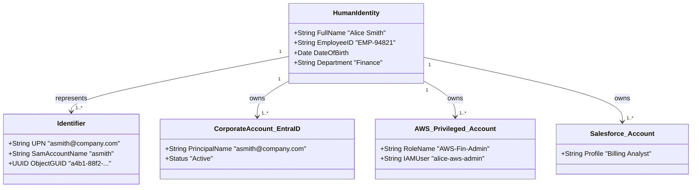

# 02. Identity vs Account vs Identifier

[⬅️ Prev: What is IAM](./01_What_is_IAM.md) | [Back to Fundamentals](./README.md) | [Next: Authentication vs Authorization ➡️](./03_Authentication_vs_Authorization.md)

---

### 1. The Core Distinctions

Beginners often use "Identity", "Account", and "User" interchangeably. In enterprise IAM architecture, confusing these leads to broken governance and severe audit failures.

---

### 2. Detailed Technical Definitions

#### A. Identity (The Entity)
- **Definition**: The unique real-world entity being represented. This can be a human employee, a contractor, a customer, or even a non-human machine/service.
- **Properties**: Persistent. Alice Smith remains Alice Smith regardless of whether she changes her last name, gets promoted, or leaves the company and gets rehired 2 years later.
- **Source of Truth**: The Human Resources Information System (HRIS) such as Workday, SAP SuccessFactors, or BambooHR.

#### B. Identifier (The Handle)
- **Definition**: The unique token, string, or key used to reference an identity within a directory service.
- **Examples**:
  - `ObjectGUID`: Immutable 128-bit integer in Active Directory.
  - `UserPrincipalName (UPN)`: `alice.smith@contoso.com`.
  - `Employee Number`: `E-10492`.
- **Key Insight**: Identifiers should ideally be immutable. If an identifier is based on a mutable attribute (like marriage changing a surname), downstream systems break.

#### C. Account (The Container of Access)
- **Definition**: A digital record created within a specific target system or application that stores credentials, entitlements, and profile information for a given identity.
- **Relationship**: A single **Identity** typically owns **multiple Accounts**:
  - Alice has a Microsoft 365 Account for email.
  - Alice has a CyberArk Vault Account for privileged access.
  - Alice has an AWS IAM User for cloud console administration.
  - Alice has a GitHub Enterprise Account for code review.

---

### 3. Comparison Matrix

| Property | Identity | Identifier | Account |
| :--- | :--- | :--- | :--- |
| **Real-world Equivalent** | A human being | A passport number or Social Security Number | A hotel room key or library membership card |
| **Cardinality** | 1 per person | Multiple per person (UPN, EmployeeID, GUID) | Many per person (one per system) |
| **Lifecycle** | Governed by HR status | Bound to identity lifecycle | Created, disabled, deleted by provisioning engines |
| **Security Risk** | Identity Theft / Impersonation | Collisions / Spoofing | Orphaned accounts, privilege creep, credential stuffing |

---

### 4. Why This Distinction Matters in Production

#### The "Orphaned Account" Vulnerability
If an organization only tracks accounts rather than linking them to an authoritative identity:
1. Alice resigns from the Finance team.
2. HR marks Alice as terminated.
3. IT deletes her primary Office 365 account.
4. **However**, her local AWS IAM account (`alice-aws-admin`) was never tied to her central identity.
5. Her AWS account remains active indefinitely as an **Orphaned Account**, creating a back-door for unauthorized access.

Enterprise IGA platforms (like SailPoint) maintain a **Single Identity Record** that maps to all correlated accounts across cloud, on-premises, and legacy databases. When the Identity status flips to `Terminated`, every linked account is revoked simultaneously.
