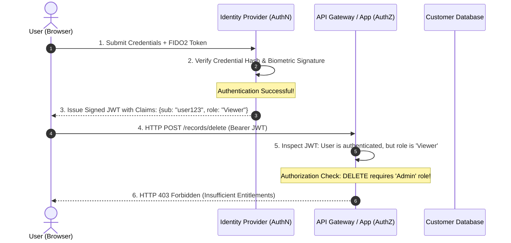

# 03. Authentication vs Authorization

[⬅️ Prev: Identity vs Account](./02_Identity_vs_Account_vs_Identifier.md) | [Back to Fundamentals](./README.md) | [Next: Zero Trust Identity Model ➡️](./04_The_Zero_Trust_Identity_Model.md)

---

### 1. Conceptual Distinction

One of the most frequent mistakes in cybersecurity is treating **Authentication** and **Authorization** as interchangeable. They address two fundamentally different questions:

- **Authentication (AuthN)**: *"Who are you?"* (Identity verification)
- **Authorization (AuthZ)**: *"What are you permitted to do?"* (Access decision)

> 💡 **Analogy**: Boarding a Commercial Airline Flight:
> 1. At airport security (TSA), an officer checks your physical passport and scans your face. They confirm that you are truly John Doe. **This is Authentication (AuthN)**.
> 2. At the airplane gate, the scanner reads your boarding pass. It confirms you are assigned seat 14B in Economy, meaning you cannot walk up and sit in First Class Suite 1A, nor can you enter the cockpit. **This is Authorization (AuthZ)**.
> Proving who you are does not grant you the right to enter every room.

---

### 2. Deep Comparison Matrix

| Dimension | Authentication (AuthN) | Authorization (AuthZ) |
| :--- | :--- | :--- |
| **Core Question** | Who is the caller/user? | What actions can the verified caller perform? |
| **Execution Order** | Must ALWAYS occur first. | Occurs second, only after AuthN succeeds. |
| **Input Artifacts** | Passwords, TOTP tokens, FIDO2 WebAuthn keys, X.509 certificates. | Security tokens containing claims, scopes, groups, roles, ABAC policies. |
| **Protocols & Standards** | Kerberos, OpenID Connect (OIDC), SAML 2.0 (AuthnRequest), FIDO2/WebAuthn. | OAuth 2.0 (Access Tokens), XACML, OPA (Open Policy Agent Rego), AWS IAM Policies. |
| **Visibility** | Directly visible to and experienced by the end-user (login prompts, MFA push). | Largely invisible to user; enforced by backend API gateways and services. |
| **Failure Response** | `401 Unauthorized` (Misnamed in HTTP: technically means *Unauthenticated*). | `403 Forbidden` (User is authenticated, but lacks sufficient permissions). |

---

### 3. Step-by-Step Technical Execution Flow

---

### 4. Common Security Vulnerabilities

#### A. Broken Object-Level Authorization (BOLA / IDOR)
- **Mechanism**: The application correctly authenticates the user, but fails to check whether the authenticated user owns the specific object requested.
- **Example**: User 102 logs in successfully (`HTTP 200`). Then they request `GET /api/invoices?id=103`. The server verifies that User 102 is authenticated and returns User 103's private financial data.
- **Remediation**: Always enforce authorization checks at the data layer against the current authenticated subject context.

#### B. Confused Deputy Attack
- **Mechanism**: A privileged service is tricked by an unprivileged user into performing an action on the user's behalf that the user themselves lacks permission to execute.
