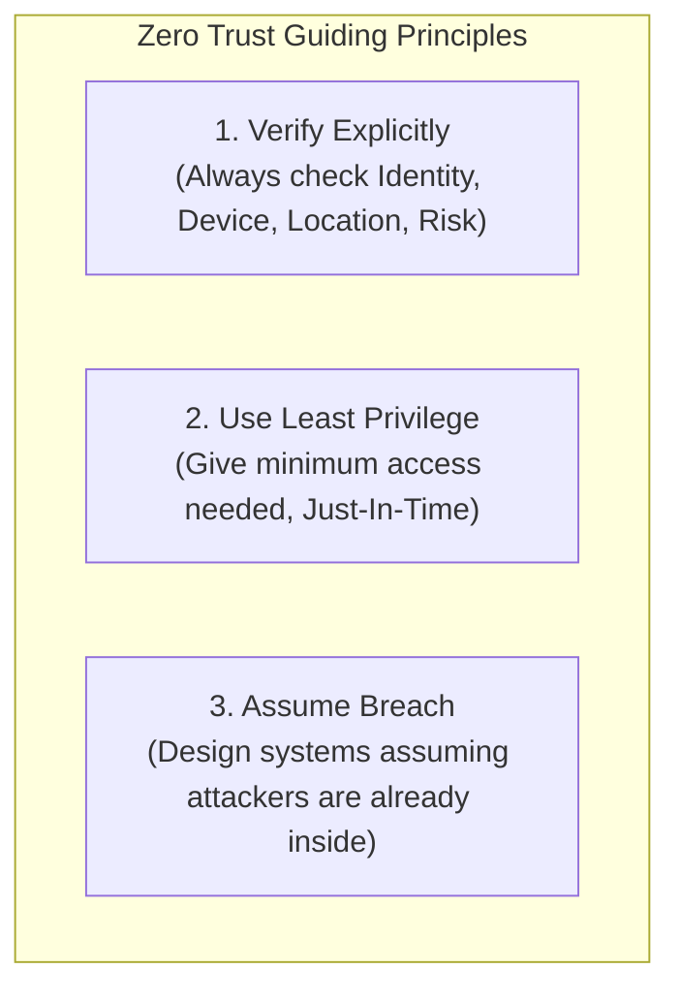
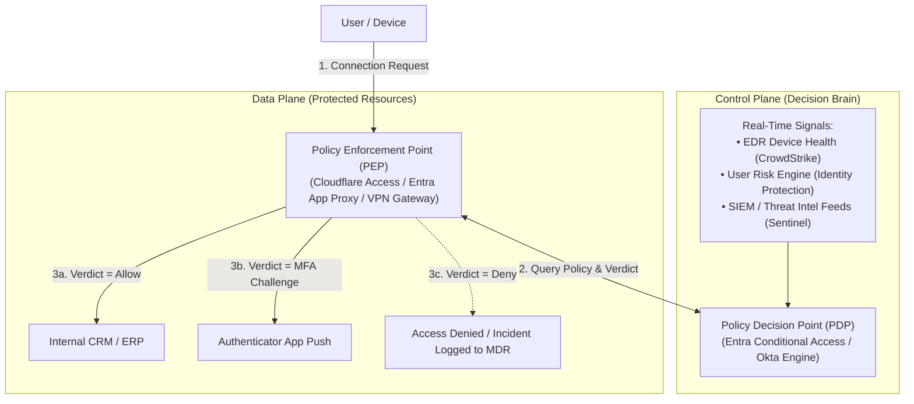
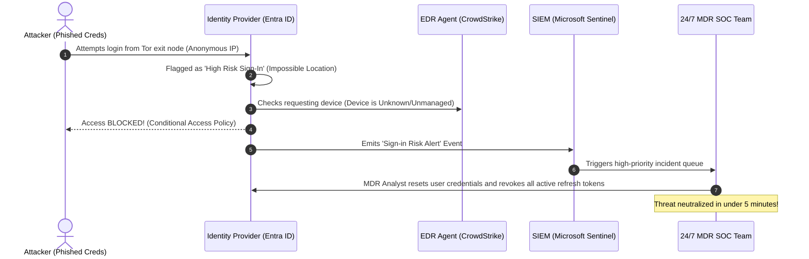

# 04. The Zero Trust Identity Model

[⬅️ Prev: AuthN vs AuthZ](./03_Authentication_vs_Authorization.md) | [Back to Fundamentals](./README.md) | [Next: Core Concepts Track ➡️](../02_Core_Concepts/README.md)

---

### 🎓 Beginner's Compass: Decoded Concepts in This Guide
- **Zero Trust**: A security philosophy that means *"Never trust, always verify."* It assumes threats exist both outside AND inside the corporate network.
- **Castle-and-Moat**: The old, broken security model where anyone inside the office Wi-Fi or VPN was automatically trusted with everything.
- **PEP (Policy Enforcement Point)**: The digital security gate (e.g., a login page, VPN gateway, or web reverse proxy) that blocks or permits user traffic.
- **PDP (Policy Decision Point)**: The "brain" (e.g., Microsoft Entra Conditional Access) that analyzes risk signals and decides: *"Allow", "Require MFA",* or *"Block".*
- **EDR (Endpoint Detection and Response)**: Antivirus on steroids installed on laptops (e.g., CrowdStrike Falcon, Microsoft Defender) that monitors for malware and suspicious activity.
- **MDR (Managed Detection and Response)**: A 24/7 outsourced team of security experts who watch your EDR and SIEM alerts and actively neutralize hackers when your internal team is asleep.
- **SIEM (Security Information and Event Management)**: The central log collector (e.g., Splunk, Microsoft Sentinel) where every login, firewall block, and server error is recorded and analyzed.

---

### 1. Plain-English Walkthrough: The Castle vs. The Modern Airport

#### The Old Way: Castle and Moat (Implicit Trust)
Imagine a medieval castle surrounded by a wide moat and a drawbridge. 
- The guards at the drawbridge check your identity once as you enter.
- Once you cross the drawbridge and step inside the castle courtyard, **nobody asks for your ID ever again**.
- You can walk into the royal kitchen, the armory, the treasury, and the king's private bedchamber without anyone stopping you.
- **The Catastrophe**: If an assassin disguises themselves as a baker or slips over the moat at night, they have free rein to poison the well or steal the gold. In IT, this was the corporate office network or legacy VPN: once connected, an attacker could scan and compromise every database and file share.

#### The Modern Way: Zero Trust (Continuous Explicit Verification)
Think of an international high-security airport:
- **Perimeter Check**: You scan your boarding pass to enter the terminal.
- **Security Checkpoint**: TSA inspects your bags, scans your body, and verifies your passport.
- **Duty-Free Shopping**: You show your boarding pass again before buying electronics or perfume.
- **Airline Lounge**: You scan your frequent flyer badge to enter the lounge.
- **Boarding Gate**: The gate agent re-checks your passport and scans your face/ticket right at the airplane door.
- **Cockpit Door**: Even inside the plane, passengers are locked out. Only certified pilots with secure passcodes enter the cockpit.
- **The Zero Trust Rule**: Just because you are standing inside Terminal 2 does **not** mean you can open the cockpit door of Flight 747!

---

### 2. The Three Cardinal Principles of Zero Trust (NIST SP 800-207)

#### Principle 1: Verify Explicitly
- Never assume a connection is safe because it comes from inside the corporate headquarters.
- Always validate:
  1. **Who are you?** (Username + Phishing-resistant MFA).
  2. **What device are you using?** (Is it a company-managed laptop? Is the disk encrypted? Is EDR healthy?).
  3. **Where are you connecting from?** (Is this an impossible travel alert—logging in from Dallas, Texas and Frankfurt, Germany 10 minutes apart?).
  4. **What data are you trying to touch?** (Is it public marketing slides or confidential financial ledgers?).

#### Principle 2: Use Least Privileged Access
- Give users only the exact permissions they need to do their job right now, and nothing more.
- **Just-In-Time (JIT)**: Instead of an administrator having 24/7/365 server root access, they have zero access until they submit a ticket. Access is granted for 4 hours and then automatically revoked.
- **Just-Enough-Access (JEA)**: A helpdesk engineer can reset user passwords, but cannot delete user accounts or alter audit logs.

#### Principle 3: Assume Breach
- Act as if an attacker already has credentials or is sitting on a laptop in your network.
- **Microsegmentation**: Prevent lateral movement. Even if an attacker compromises a web server, firewall rules and identity policies prevent that server from talking to the customer database.
- **End-to-End Encryption**: Encrypt data both in transit (TLS 1.3) and at rest (AES-256).

---

### 3. Architecture: The Control Plane and Data Plane

Zero Trust splits cybersecurity operations into two distinct layers:

| Component | Industry Role | Real-World Example |
| :--- | :--- | :--- |
| **PEP (Policy Enforcement Point)** | The digital turnstile that physically inspects and intercepts traffic. | Cloudflare Zero Trust, Microsoft Application Proxy, F5 BIG-IP APM. |
| **PDP (Policy Decision Point)** | The brain that evaluates business rules, risk scores, and compliance. | Microsoft Entra ID Conditional Access, Okta Adaptive Policy Engine. |
| **PIP (Policy Information Point)** | The signal sources feeding the PDP with real-time telemetry. | CrowdStrike Falcon (device health), Intune (compliance), Splunk/Sentinel (threat logs). |

---

### 4. How IAM Connects to SOC, EDR, and MDR in Zero Trust

Beginners often ask: *"Is IAM separate from SOC and MDR?"*  
**Answer**: In Zero Trust, they are deeply connected!

1. **IAM (Identity Engine)**: Blocks the unauthorized login attempt because the device lacks a valid company certificate and originates from an anomalous IP.
2. **EDR (Endpoint Agent)**: Verifies whether the requesting machine has malware or disabled firewall settings.
3. **SIEM (Central Log Aggregator)**: Ingests the failed login telemetry from the IAM platform.
4. **MDR (Managed Detection Team)**: Human threat hunters receive the correlation alert, investigate the affected user's mailbox for phishing, and trigger an automated account lockdown.

---

### 5. Common Beginner Mistakes vs. Best Practices

| Common Beginner Mistake | Real-World Risk | Industry Best Practice |
| :--- | :--- | :--- |
| **Assuming VPN equals Zero Trust** | VPNs grant full network layer-3 access to entire subnets once connected. Compromising one VPN account lets hackers scan the whole network. | Replace VPNs with **Zero Trust Network Access (ZTNA)** solutions (e.g., Zscaler, Cloudflare Access) that grant access to individual web apps only. |
| **One-time authentication** | Authenticating at 9:00 AM and trusting the session until 5:00 PM allows token theft and session hijacking. | Implement **Continuous Access Evaluation (CAE)** so if a user account is disabled or password changed, sessions revoke in real time. |
| **Exempting executives from MFA** | Threat actors deliberately target C-level executives (spear-phishing / whaling) because they possess elevated access. | Enforce phishing-resistant hardware security keys (FIDO2 / YubiKey) for all executives and administrators with zero exemptions. |

---

### 6. Recommended Next Steps
Proceed to the next module to master how identities are tracked, modeled, and governed across their enterprise lifecycle:
- [02. Core Concepts: Identity Lifecycle and JML ➡️](../02_Core_Concepts/01_Identity_Lifecycle_and_JML.md)
