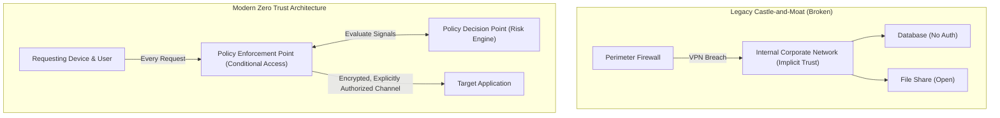
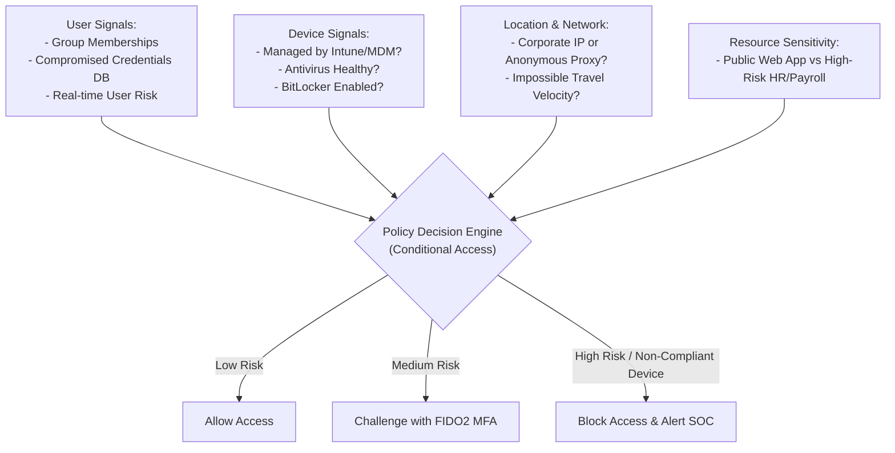

# 04. The Zero Trust Identity Model

[⬅️ Prev: AuthN vs AuthZ](./03_Authentication_vs_Authorization.md) | [Back to Fundamentals](./README.md) | [Next: Core Concepts Track ➡️](../02_Core_Concepts/README.md)

---

### 1. The Death of the Castle-and-Moat Architecture

Historically, enterprise security relied on the **perimeter security model** (the "Castle and Moat"):
- Everything outside the corporate firewall was hostile.
- Everything inside the corporate network (LAN or VPN) was trusted.

Once an attacker or compromised laptop breached the perimeter, they had unfettered lateral movement across the entire corporate network.

---

### 2. Core Zero Trust Principles (NIST SP 800-207)

1. **Verify Explicitly**: Always authenticate and authorize based on all available data points—including user identity, location, device health, service or workload, data classification, and anomalies.
2. **Use Least Privileged Access**: Limit user access with Just-In-Time (JIT) and Just-Enough-Access (JEA), risk-based adaptive policies, and data protection.
3. **Assume Breach**: Minimize blast radius and segment access. Verify end-to-end encryption and use analytics to gain visibility and improve threat detection.

---

### 3. Identity as the Primary Control Plane

In Zero Trust, **Identity replaces the Corporate Network** as the boundary of control.

Before granting access to any resource, the Identity Provider evaluates dynamic signals in real time:

---

### 4. Key Metrics for Zero Trust Identity Maturity

- **100% MFA Enforcement**: No legacy basic authentication (POP3, IMAP, NTLM).
- **Device Health Verification**: Only compliant, enrolled devices can connect to SaaS data.
- **Continuous Access Evaluation (CAE)**: If an active session user gets fired or their password is changed, their active tokens are revoked across all apps within seconds, rather than waiting for token expiration.
