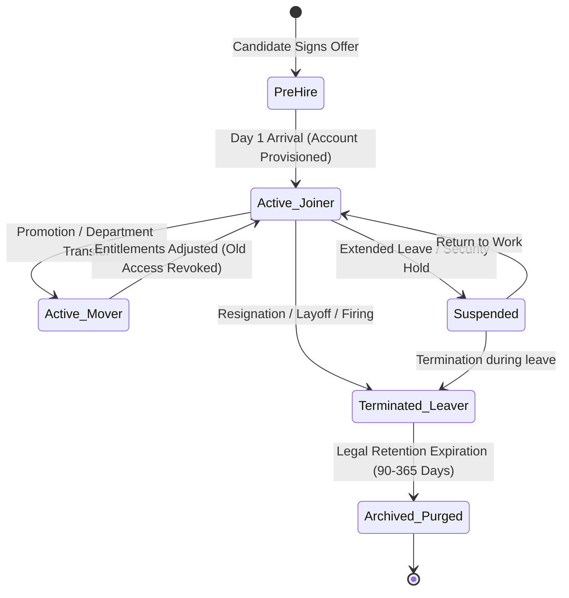

# 01. Identity Lifecycle Management and the JML Process

[⬅️ Back to Core Concepts](./README.md) | [Next: RBAC vs ABAC ➡️](./02_RBAC_vs_ABAC_Access_Models.md)

---

### 1. Definition and Purpose

**Identity Lifecycle Management (ILM)** refers to the automated, continuous governance of a user's digital identity and access entitlements from their initial hire date until their permanent separation from the enterprise.

The backbone of ILM in any mature organization is the **JML Process**:
- **Joiner**: Onboarding an employee or contractor, establishing their authoritative identity record, and automatically provisioning baseline birthright access.
- **Mover**: Handling internal promotions, department transfers, or temporary assignments by granting new permissions and revoking old, unneeded entitlements.
- **Leaver**: Immediate, deterministic deprovisioning of all accounts, tokens, and access rights upon resignation, termination, or contract end.

> 💡 **Analogy**: Consider a hotel guest's room keycard:
> - **Joiner**: When you check in at the front desk, they verify your reservation and give you a keycard coded for your room and the gym.
> - **Mover**: If you upgrade to the penthouse on day two, the front desk updates your keycard so it opens the penthouse and executive lounge, while simultaneously disabling access to your previous standard room.
> - **Leaver**: When checkout time arrives at 11:00 AM, the keycard is instantly deactivated. You cannot wander back into the room after you depart.

---

### 2. The JML Lifecycle Architecture

---

### 3. Deep Dive into the Three JML Phases

#### Phase 1: Joiner (Birthright Provisioning)
- **Authoritative Source**: HR records created in Workday with Start Date, Department, Job Title, Manager, and Cost Center.
- **Mechanism**:
  1. IGA platform detects new record via daily delta sync or real-time webhook.
  2. Generates immutable unique identifier (e.g., `EmployeeNumber: 849201`).
  3. Provisions core corporate account in Primary Identity Provider (Entra ID / Active Directory).
  4. Automatically assigns **Birthright Roles**: corporate email (Exchange Online), corporate chat (Slack/Teams), intranet, and general HR self-service portal.
  5. Triggers welcome email to the manager with a temporary, one-time Temporary Access Pass (TAP) for Day 1 passwordless setup.

#### Phase 2: Mover (Privilege Creep Mitigation)
- **The Danger**: When Bob moves from Customer Support to Software Engineering, IT frequently adds the "Developer" role but forgets to remove the "Support Representative" role. Over 5 years, Bob accumulates dozens of conflicting roles. This is known as **Privilege Creep**.
- **Mechanism**:
  1. HR updates Bob's Department attribute from `Support` to `Engineering`.
  2. IGA platform evaluates role differences:
     - Grants new required roles (`GitHub-Developers`, `AWS-Dev-Sandbox`).
     - **Revokes** obsolete roles (`Zendesk-Support-Agent`, `Customer-DB-Viewer`).
  3. Triggers an automated notification to Bob's new manager requesting verification of retained entitlements.

#### Phase 3: Leaver (Deprovisioning and Blast Radius Zeroing)
- **The Danger**: Terminated employees retaining active sessions or dormant accounts are responsible for some of the most damaging corporate data theft incidents.
- **Mechanism**:
  1. HR enters termination timestamp into Workday.
  2. IGA triggers emergency or scheduled deprovisioning workflow:
     - Disables user account in Entra ID/Active Directory immediately.
     - Revokes all active OAuth refresh tokens and kills active browser SSO sessions (via Continuous Access Evaluation - CAE).
     - Revokes CyberArk/PAM checkouts and rotates any shared service credentials the user knew.
     - Triggers automated SCIM deprovisioning requests to downstream SaaS apps (Salesforce, Google Workspace, GitHub).
     - Reassigns critical data and calendar events to the user's manager.
     - Moves user object to an `OU=Disabled_Users` organizational unit.

---

### 4. Common JML Failures and How to Prevent Them

| Failure Mode | Root Cause | Enterprise Prevention |
| :--- | :--- | :--- |
| **Contractor accounts active months after contract ends** | Contractors often bypass HR systems and are created manually via IT tickets. | Enforce mandatory expiration dates on all non-employee accounts; integrate Vendor Management Systems (Fieldglass) with IGA. |
| **Terminated user accesses email from personal phone** | Active EAS (Exchange ActiveSync) or mobile OAuth tokens remain cached even if password is changed. | Use automated token revocation APIs (`Revoke-MgUserSignInsSession`) and enforce Intune device wipe. |
| **Toxic Combinations / Separation of Duties (SoD)** | Mover retains financial approval rights while gaining payment creation rights. | Implement automated SoD collision detection rules in the IGA platform that automatically block conflicting role grants. |
