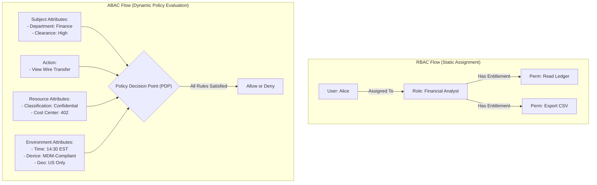

# 02. Access Control Models: RBAC vs ABAC vs PBAC

[⬅️ Prev: Identity Lifecycle & JML](./01_Identity_Lifecycle_and_JML.md) | [Back to Core Concepts](./README.md) | [Next: SSO and Federation ➡️](./03_Single_Sign_On_SSO_and_Federation.md)

---

### 1. Conceptual Breakdown

How does a system decide whether an authenticated user is permitted to view, edit, or delete a specific file, server, or customer record? In enterprise IAM, this is determined by the **Access Control Model**.

The two primary architectures are:
- **RBAC (Role-Based Access Control)**: Permissions are assigned to broad roles, and roles are assigned to users.
- **ABAC (Attribute-Based Access Control)**: Permissions are evaluated dynamically at runtime based on attributes of the subject, object, action, and environment.

> 💡 **Analogy**:
> - **RBAC** is like a standard amusement park ticket: A "Gold Pass" wristband lets you enter all rollercoasters, while a "Silver Pass" lets you enter children's rides only. Your individual age, the weather, or the time of day does not change what the wristband permits.
> - **ABAC** is like a high-tech smart door: The door checks your age (subject attribute), the current time (environment attribute: must be between 9 AM and 5 PM), your current location (must be on corporate WiFi), and whether the file you are viewing is classified as 'Secret' (resource attribute). Even if you are a manager, access is denied if you attempt it from an untrusted public coffee shop at midnight.

---

### 2. Technical Comparison



| Dimension | Role-Based Access Control (RBAC) | Attribute-Based Access Control (ABAC) |
| :--- | :--- | :--- |
| **Primary Standard** | ANSI INCITS 359-2004 | XACML 3.0 / NIST SP 800-162 |
| **Logic Formulation** | `If User is member of Role X -> Grant Access` | `If Subject.Dept == Resource.Owner && Env.Time < 18:00 -> Grant Access` |
| **Management Overhead** | Simple to understand initially, but suffers from **Role Explosion** (e.g., creating 5,000 distinct roles for 1,000 employees). | Higher initial complexity to design policies, but scales dynamically with zero role explosion. |
| **Contextual Awareness** | Low. Cannot easily evaluate device compliance, network risk, or time of day. | High. Evaluates environmental signals in real-time. |
| **Audit Simplicity** | Very easy for compliance auditors to inspect static role membership. | Harder for auditors to visualize static access matrices because decisions are calculated at runtime. |

---

### 3. Policy-Based Access Control (PBAC): The Modern Hybrid

In modern multi-cloud architectures, organizations combine RBAC and ABAC into **Policy-Based Access Control (PBAC)**, often implemented using policy engines like **Open Policy Agent (OPA)** with Rego:

```rego
# Enterprise OPA Policy Example: Restricting Medical Record Access
package corporate.healthcare.access

default allow = false

# Allow doctor to view patient record only if assigned to that patient and using compliant device
allow {
    input.action == "read"
    input.user.role == "Physician"
    input.resource.assigned_physician_id == input.user.employee_id
    input.device.is_mdm_compliant == true
    input.network.is_corporate_ip == true
}
```

---

### 4. Implementation Best Practices

1. **Use RBAC for coarse-grained access**: Assign baseline application access based on department and job function (e.g., all Salesforce users get the "Sales Rep" role).
2. **Use ABAC for fine-grained authorization**: Restrict access within the application based on customer territory, data classification level, or device posture.
3. **Audit for Role Explosion**: If your directory contains more groups/roles than active human employees, your RBAC model is broken. Refactor into parameterized attributes.
