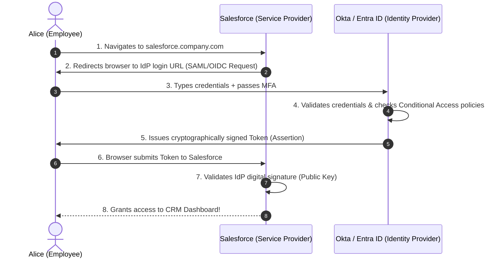

# 03. Single Sign-On (SSO) and Identity Federation

[⬅️ Prev: RBAC vs ABAC](./02_RBAC_vs_ABAC_Access_Models.md) | [Back to Core Concepts](./README.md) | [Next: Multi-Factor Authentication ➡️](./04_Multi_Factor_Authentication_MFA.md)

---

### 🎓 Beginner's Compass: Decoded Acronyms & Tools
- **SSO (Single Sign-On)**: A technology that lets a user log in with one username and password once, and automatically get logged into all their work tools (Slack, Zoom, Salesforce, Jira) without typing credentials again.
- **IdP (Identity Provider)**: The single "Source of Truth" where passwords and identities live (e.g., Microsoft Entra ID, Okta, Ping Identity). It is the agency that issues your digital passport.
- **SP (Service Provider)**: The target application the user wants to use (e.g., Salesforce, GitHub, Workday, Zoom). It trusts the IdP.
- **Identity Federation**: Linking identity systems across different companies or security domains (e.g., logging into Spotify or Airbnb using your Google account).
- **SAML (Security Assertion Markup Language)**: An XML-based protocol commonly used for enterprise web SSO.
- **OIDC (OpenID Connect)**: A modern, JSON/REST-based protocol used for web and mobile app authentication.

---

### 1. Plain-English Walkthrough: The Disney World Analogy

#### Without SSO (The Password Nightmare)
Imagine visiting an amusement park with 40 different rollercoasters:
- To ride Space Mountain, you must buy a ticket with a new username and password.
- To ride Pirates of the Caribbean, you must create another username and password.
- By noon, you have 40 different sticky notes with passwords in your pocket.
- You forget your password for the Haunted Mansion, get locked out, and spend 45 minutes waiting at Guest Services.
- **Enterprise Reality**: Without SSO, employees reuse weak passwords like `Summer2026!` across 50 SaaS tools. When one service gets breached, hackers compromise all of them.

#### With SSO (The MagicBand Solution)
When you check in at the park hotel entrance:
- The front desk (the **IdP**) checks your government ID and hands you an electronic RFID wristband (**SSO Token / MagicBand**).
- When you walk up to Space Mountain (the **SP**), you tap your wristband. The ride scanner asks the hotel system: *"Is this person valid?"* The hotel system replies: *"Yes, that is Alice, she paid for a VIP pass."*
- Alice enters the ride without ever re-entering her password!

---

### 2. SSO vs. Identity Federation: What is the Difference?

| Feature | Single Sign-On (SSO) | Identity Federation |
| :--- | :--- | :--- |
| **Scope** | Usually within a single organization or single IdP boundary. | Across separate organizations, domains, or third-party cloud ecosystems. |
| **Real-World Analogy** | Using your room keycard to open your hotel room, the hotel gym, and the pool. | Using your United States Passport to enter Japan, France, or Canada. |
| **Example** | An employee logs into Okta once and accesses corporate Gmail, Jira, and Slack. | A supplier at Company B logs into their own corporate portal to access Company A's shared vendor portal. |
| **Dominant Protocols** | SAML 2.0, OpenID Connect (OIDC), Kerberos (on-prem). | SAML 2.0 WebSSO, WS-Federation, OIDC with Cross-Tenant trust. |

---

### 3. Why Cybersecurity Teams Mandate SSO

1. **Centralized Kill Switch**: When an employee is fired, the IAM engineer disables their single account in Microsoft Entra ID or Okta. Instantly, the ex-employee loses access to all 80+ connected SaaS applications at once. Without SSO, IT would have to manually log into 80 separate admin panels to delete accounts!
2. **Unified Security Policies (MFA everywhere)**: Rather than hoping each SaaS tool supports strong MFA, SSO enforces MFA at the front door before the user can touch any application.
3. **Eliminates Password Fatigue & Phishing**: Users only remember one master passphrase or use passwordless authentication (FIDO2 / Windows Hello).

---

### 4. Common Beginner Mistakes vs. Best Practices

| Common Beginner Mistake | Real-World Risk | Industry Best Practice |
| :--- | :--- | :--- |
| **Allowing Local Backdoor Accounts** | Leaving direct username/password logins enabled on SaaS apps (e.g., Salesforce admin login bypassing SSO) allows attackers to bypass MFA. | Disable local passwords on Service Providers; enforce SAML/OIDC SSO with zero local bypass except for one break-glass emergency account. |
| **Expired Signing Certificates** | SAML assertions are signed with digital X.509 certificates. If the certificate expires, all 10,000 employees are instantly locked out of all cloud apps! | Set up automated 60-day alerts in your SIEM/monitoring tools to renew IdP signing certificates before expiration. |
| **Neglecting Session Lifetimes** | Setting SSO session lifetimes to 30 days means stolen laptop cookies remain valid for an entire month without re-authentication. | Set sensible session timeouts (e.g., 8–12 hours for standard users; 1 hour for privileged administrators). |

---

### 5. Recommended Next Steps
Now that you understand how users log in once, learn how we protect that front door from being hacked:
- [04. Multi-Factor Authentication (MFA) Deep Dive ➡️](./04_Multi_Factor_Authentication_MFA.md)
