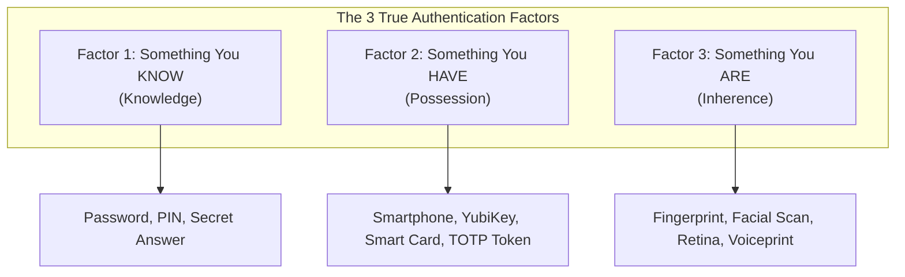
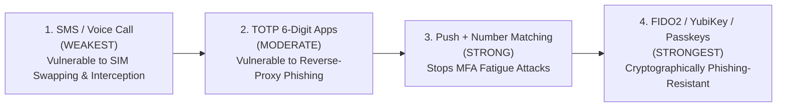

# 04. Multi-Factor Authentication (MFA)

[⬅️ Prev: SSO & Federation](./03_Single_Sign_On_SSO_and_Federation.md) | [Back to Core Concepts](./README.md) | [Next: Privileged Access Management ➡️](./05_Privileged_Access_Management_PAM.md)

---

### 🎓 Beginner's Compass: Decoded Acronyms & Tools
- **MFA (Multi-Factor Authentication)**: A security system requiring at least two independent proof factors before granting access.
- **Factor**: A distinct category of evidence. Two passwords do NOT make MFA (that is just two of the same factor!).
- **TOTP (Time-based One-Time Password)**: The 6-digit rolling code generated every 30 seconds on apps like Google Authenticator or Microsoft Authenticator.
- **Push Notification**: An alert sent to your smartphone asking: *"Did you just try to log in? [Approve] / [Deny]"*.
- **Number Matching**: A security feature where the login screen displays a two-digit number (e.g., "47") that you must type into your phone app. This stops "MFA Fatigue" attacks.
- **FIDO2 / WebAuthn**: The gold standard of phishing-resistant authentication using hardware security keys (like YubiKey) or device biometrics (Windows Hello, Apple Touch ID/Face ID).
- **MFA Fatigue (Push Bombing)**: When a hacker spams an employee's phone with 50 login approval prompts at 3:00 AM until the exhausted employee accidentally taps "Approve".

---

### 1. The Three Authentic Authentication Factors

To qualify as true MFA, credentials must come from at least **two different categories**:

> [!IMPORTANT]
> A password plus a PIN is **NOT** Multi-Factor Authentication. Both belong to the same category (*Something you know*). That is merely **Two-Step Verification (2SV)** using single-factor knowledge.

---

### 2. MFA Methods Ranked: Weakest to Strongest

Not all MFA is created equal. Attackers have developed sophisticated tools (such as Evilginx) to bypass older MFA methods:

| Method | How it Works | Security Level | Primary Attack Vulnerability |
| :--- | :--- | :--- | :--- |
| **SMS / Phone Call** | Cellular carrier sends a 6-digit text message to your phone. | **Very Weak** | **SIM Swapping**: Attacker tricks your phone carrier into moving your phone number to their SIM card. |
| **TOTP (Google/MS Auth)** | Mobile app calculates an HMAC-SHA hash based on a shared secret key and the current 30-second UNIX clock. | **Moderate** | **Adversary-in-the-Middle (AiTM)**: Phishing tool intercepts the code and uses it immediately before it expires. |
| **Push with Number Matching** | Phone vibrates showing an input box. User must type the number shown on their computer monitor. | **Strong** | Defeats accidental approvals and MFA Fatigue spamming. |
| **FIDO2 / WebAuthn (YubiKey)** | Public/private key cryptography bound to the exact domain origin (URL) in the browser. | **Maximum (Phishing-Proof)** | Private key never leaves the hardware chip. If you are on `evil-phishing-site.com`, the hardware key refuses to sign the challenge! |

---

### 3. Real-World Attack Scenario: MFA Fatigue & Number Matching

#### The Attack Without Number Matching
1. The attacker buys Alice's password on the dark web.
2. At 2:30 AM, the attacker inputs Alice's credentials into her company portal.
3. Alice's smartphone buzzes with a Microsoft Authenticator prompt: `[Approve] or [Deny]?`
4. Alice denies it and goes back to sleep.
5. The attacker's script triggers 40 more push prompts in rapid succession: *Buzz... Buzz... Buzz...*
6. Half-asleep and frustrated by the continuous vibration, Alice taps **[Approve]** to silence the phone.
7. **Result**: The attacker breaches the internal network. (This was the exact technique used in the 2022 Uber breach).

#### The Defense: Number Matching
With number matching enabled:
1. The computer screen shows: *"Enter number **83** on your mobile device."*
2. The attacker cannot see Alice's phone, and Alice cannot see the attacker's screen.
3. Alice sees a prompt asking for a 2-digit number she does not know.
4. Alice taps **[Report Suspicious Activity]**, alerting the SOC/MDR team immediately!

---

### 4. Common Beginner Mistakes vs. Best Practices

| Common Beginner Mistake | Real-World Risk | Industry Best Practice |
| :--- | :--- | :--- |
| **Relying solely on SMS for IT Admins** | Hackers bribe mobile carrier employees or execute automated SIM swaps to hijack executive numbers. | Ban SMS and voice calls for privileged accounts. Mandate FIDO2 hardware tokens (YubiKeys). |
| **"Remember this device for 90 days"** | If a laptop is stolen or malware steals session cookies, the attacker remains authenticated for 3 months. | Keep remember-device windows short (e.g., 24 hours to 7 days max) and enforce device health checks via Intune/EDR. |
| **No Break-Glass (Emergency) MFA Plan** | If the cloud MFA provider suffers a global outage, all employees including administrators are locked out. | Maintain two dedicated cloud-only Emergency Access Accounts ("Break-Glass accounts") with complex 30+ character passphrases stored in physical tamper-evident safes. |

---

### 5. Recommended Next Steps
Once standard users are secured with MFA, how do we protect the most dangerous accounts in the company (Domain Admins and Cloud Engineers)?
- [05. Privileged Access Management (PAM) Deep Dive ➡️](./05_Privileged_Access_Management_PAM.md)
