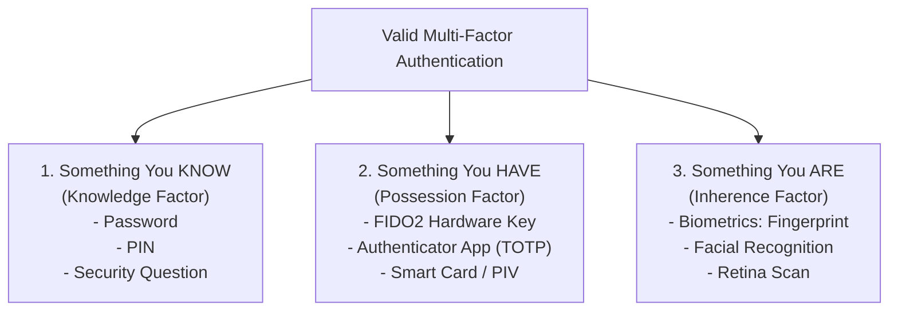
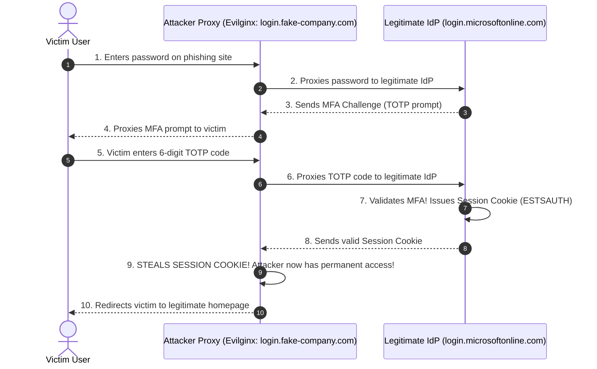

# 04. Multi-Factor Authentication (MFA) and Phishing Resistance

[⬅️ Prev: SSO and Federation](./03_Single_Sign_On_SSO_and_Federation.md) | [Back to Core Concepts](./README.md) | [Next: Privileged Access Management ➡️](./05_Privileged_Access_Management_PAM.md)

---

### 1. The Core Philosophy of MFA

Passwords alone are thoroughly compromised in modern computing due to credential stuffing, data breaches, keyloggers, and phishing. Multi-Factor Authentication (MFA) requires a user to provide **two or more distinct authentication factors** before access is granted.

According to NIST SP 800-63B, valid factors must come from different categories:



> ⚠️ **Critical Rule**: Supplying a password and a PIN is **NOT** MFA. Both are "Something You Know". Supplying two factors from the same category is merely Two-Step Verification, not Multi-Factor.

---

### 2. The MFA Security Hierarchy: From Weakest to Strongest

Not all MFA is created equal. Understanding this hierarchy is essential for an IAM professional:

```
[WEAKEST / VULNERABLE]
  │
  ├─► 1. SMS / Voice Call OTP
  │     - Vulnerable to SIM Swapping, SS7 telecom interception, and basic phishing.
  │
  ├─► 2. Simple Mobile Push Notification (Approve / Deny)
  │     - Vulnerable to "MFA Fatigue" (Push Bombing) where attackers trigger 50 alerts at 3 AM.
  │
  ├─► 3. Time-based One-Time Password (TOTP) Apps (Google Authenticator)
  │     - Vulnerable to Adversary-in-the-Middle (AiTM) reverse proxy phishing (Evilginx).
  │
  ├─► 4. Push Notification with Number Matching
  │     - Mitigates MFA fatigue: User must type the 2-digit number displayed on the login screen.
  │
  └─► 5. Phishing-Resistant FIDO2 / WebAuthn / Passkeys [GOLD STANDARD]
        - Cryptographically binds the authentication credential to the specific web origin (URL).
        - Mathematically impossible to phish with Evilginx or fake login pages.
[STRONGEST]
```

---

### 3. How Adversary-in-the-Middle (AiTM) Bypasses Legacy MFA

To understand why modern enterprises are migrating to **FIDO2**, look at how attackers easily bypass TOTP and basic push notifications using tools like Evilginx:



---

### 4. Why FIDO2 / WebAuthn Stops This Attack

FIDO2 authentication uses public-key cryptography where the private key never leaves the hardware security module (YubiKey or TPM chip). 
During authentication, the browser signs a challenge using the **origin domain** (`login.microsoftonline.com`). If the user is on `login.fake-company.com`, the hardware key signs for the fake domain. When the real IdP receives the assertion, it detects a domain mismatch and immediately aborts the session.
