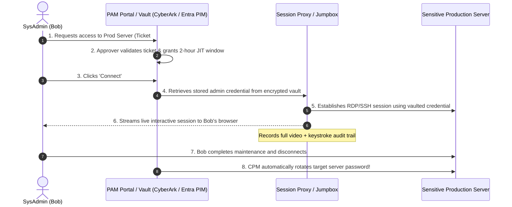
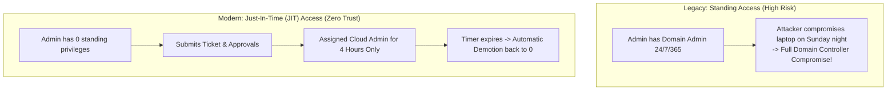

# 05. Privileged Access Management (PAM)

[⬅️ Prev: Multi-Factor Authentication](./04_Multi_Factor_Authentication_MFA.md) | [Back to Core Concepts](./README.md) | [Next: Identity Governance & Administration ➡️](./06_Identity_Governance_and_Administration_IGA.md)

---

### 🎓 Beginner's Compass: Decoded Acronyms & Tools
- **Privileged Account**: Any user account or credential with elevated administrative power (e.g., `root` on Linux, `Domain Admin` in Active Directory, `Global Administrator` in Microsoft 365, `AWS Account Root / Admin`).
- **PAM (Privileged Access Management)**: Cybersecurity tools and policies designed specifically to lock down, monitor, and record the usage of administrative accounts.
- **Vault (Digital Safe)**: An encrypted database (e.g., CyberArk Digital Vault, HashiCorp Vault) where admin passwords and SSH keys are hidden so humans never know them.
- **CPM (Central Policy Manager)**: The robot engine in CyberArk that automatically changes passwords on servers every 24 hours or immediately after each use.
- **PSM (Privileged Session Manager)**: A jump-box proxy that records a live MP4 video and keystroke log of everything an administrator types on a sensitive server.
- **JIT (Just-In-Time Access)**: Giving an engineer admin privileges for exactly 2 hours to fix an incident, then automatically taking them away.
- **PIM (Privileged Identity Management)**: The cloud-native PAM service inside Microsoft Entra ID for time-limited role activation.

---

### 1. Plain-English Walkthrough: The Bank Safe Deposit Box Analogy

#### Without PAM (The Chaos Model)
Imagine a bank where the master keys to all 500 customer safe deposit boxes are hung on a pegboard in the employee breakroom:
- Any teller, janitor, or security guard can pick up the master key, unlock any box, steal the jewelry, and put the key back.
- If diamonds go missing, nobody knows who stole them because everyone had physical access to the key.
- **In IT**: Admins share a master root password written on a sticky note. If database records get erased, the audit log simply says `root did it`, with zero attribution to which human executed the command!

#### With PAM (The CyberArk / PIM Model)
- The master keys are locked inside a blast-proof safe (**The Vault**).
- To touch a server, Engineer Bob must log into the PAM web portal with his personal account and MFA.
- Bob submits a request: *"I need to restart the Oracle payroll database for Ticket #1049."*
- Bob's manager approves the request.
- The PAM system connects Bob to the server through a secure proxy (**PSM**).
- **The Magic**: Bob **never sees or knows the password**. The PAM tool types the password into the server behind the scenes!
- While Bob works, the PAM system records his screen like an airport CCTV camera.
- When Bob logs off, the system automatically changes the server's password to a brand new 64-character random string (**Credential Rotation**).

---

### 2. Core Pillars of Enterprise PAM

1. **Credential Vaulting**: Passwords, SSH private keys, and API tokens are locked in a hardened cryptographic vault. No human administrator knows the raw password.
2. **Automated Credential Rotation**: Passwords are automatically randomized on target devices every 30, 60, or 90 days—or immediately checked in after single-use (One-Time Password / OTP mode).
3. **Privileged Session Monitoring & Recording (PSM)**: High-definition video recording and searchable keystroke logging of every remote desktop (RDP) and command-line (SSH) session. If an admin types `rm -rf /` or `DROP TABLE customers`, the SIEM/MDR team receives an instantaneous alert.
4. **Just-In-Time (JIT) Elevation**: Eliminate "standing privileges". In modern Zero Trust environments, **no human holds permanent administrator rights**. Accounts have zero privileges until elevated for a specific ticket.

---

### 3. Standing Access vs. Just-In-Time (JIT) Access

---

### 4. Common Beginner Mistakes vs. Best Practices

| Common Beginner Mistake | Real-World Risk | Industry Best Practice |
| :--- | :--- | :--- |
| **Shared Generic Admin Accounts** | 5 engineers sharing one `admin_finance` credential eliminates individual accountability during security investigations. | Prohibit shared logins. Require personal identities to check out temporary access through PAM with dual-custody approval. |
| **Ignoring Hardcoded Service Credentials** | Vaulting human passwords while leaving database connection passwords in plaintext configuration files. | Use PAM dynamic secret engines (e.g., HashiCorp Vault) to inject temporary credentials into applications via environment variables. |
| **Exempting Cloud Admins from PAM** | Protecting on-premises servers with CyberArk while engineers have permanent `Owner` rights in AWS/Azure. | Implement Microsoft Entra Privileged Identity Management (PIM) or AWS IAM Identity Center with strict JIT approval policies. |

---

### 5. Recommended Next Steps
Once passwords and admin keys are locked inside vaults, how does an organization prove to federal auditors that only authorized people have access?
- [06. Identity Governance and Administration (IGA) Deep Dive ➡️](./06_Identity_Governance_and_Administration_IGA.md)
