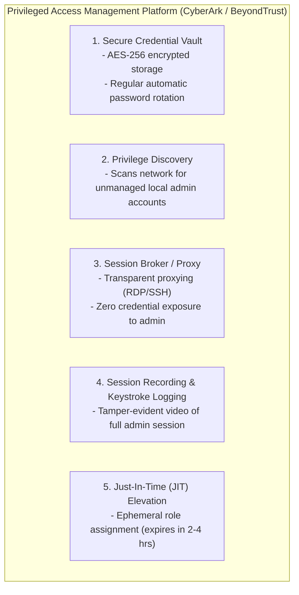
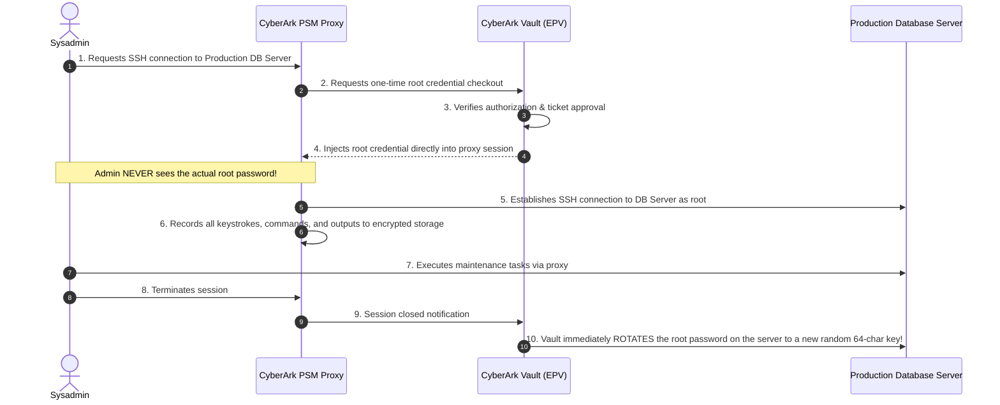

# 05. Privileged Access Management (PAM)

[⬅️ Prev: Multi-Factor Authentication](./04_Multi_Factor_Authentication_MFA.md) | [Back to Core Concepts](./README.md) | [Next: Identity Governance & Administration ➡️](./06_Identity_Governance_and_Administration_IGA.md)

---

### 1. Definition and Purpose

**Privileged Access Management (PAM)** comprises the cybersecurity strategies, tools, and policies used to monitor, control, secure, and audit all elevated ("privileged") accounts across an enterprise infrastructure.

A **Privileged Account** is any account that possesses elevated administrative permissions capable of altering system configurations, accessing sensitive customer databases, deploying enterprise-wide software, or modifying security controls (e.g., Domain Admins, Cloud Root, Database Sysadmins, Kubernetes Cluster Admins).

> 💡 **Analogy**: A Bank Safe Deposit Vault:
> - A standard employee has a normal front-door access badge (Standard IAM).
> - The bank vault holding millions of dollars cannot be opened by anyone walking around with an ordinary key.
> - The vault requires two authorized bank officers to enter their codes simultaneously (Dual Authorization), the master key is stored in a reinforced safe (Vaulting), the key must be returned immediately after the deposit box is closed (Ephemeral / Just-In-Time), and a high-definition CCTV camera records every second of the interaction (Session Recording). This is **PAM**.

---

### 2. Core Pillars of Enterprise PAM Architecture

---

### 3. Just-In-Time (JIT) vs Standing Privileges

Historically, organizations assigned engineers permanent administrative privileges (known as **Standing Privileges**). If a developer was an AWS Administrator, their account remained an administrator 24 hours a day, 7 days a week.

**The Flaw**: If that developer's credentials are leaked at 2 AM, the attacker has instant, full administrator control.

**The Zero Trust Solution (JIT)**:
- Engineers operate with standard, unprivileged accounts 99% of the day.
- When an emergency production incident occurs, they submit a JIT request via Microsoft Entra PIM or CyberArk.
- They must provide a valid Jira/ServiceNow ticket number and business justification.
- The request requires approval from their manager or secondary engineer.
- Upon approval, administrative permissions are activated for exactly **2 hours**.
- At the end of the window, permissions are automatically stripped, and the temporary credentials are cycled.

---

### 4. Technical Workflow: CyberArk Privileged Session Manager (PSM)

