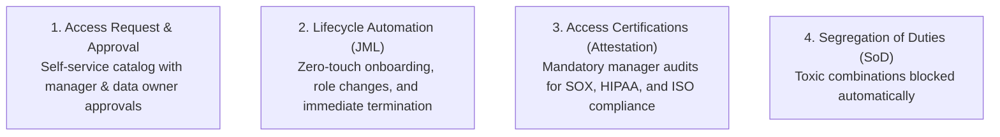

# 06. Identity Governance and Administration (IGA)

[⬅️ Prev: Privileged Access Management](./05_Privileged_Access_Management_PAM.md) | [Back to Core Concepts](./README.md) | [Next: Service Accounts & Machine Identities ➡️](./07_Service_Accounts_and_Machine_Identities.md)

---

### 🎓 Beginner's Compass: Decoded Acronyms & Tools
- **IGA (Identity Governance and Administration)**: The policy, compliance, and auditing engine that answers the ultimate question: *"Who has access to what, who approved it, and do they still need it?"*
- **Access Certification / Access Review**: A mandatory audit campaign where managers must review and sign off on every permission their employees have (e.g., *"Does Sarah still need access to payroll databases?"*).
- **SoD (Segregation of Duties)**: A security rule preventing one person from holding conflicting powers (e.g., the person who creates an invoice cannot be the same person who approves the payment).
- **Orphan Account**: An active account belonging to an employee who left the company months ago (a massive security risk!).
- **Entitlement**: A specific right or permission inside an application (e.g., `Read`, `Write`, `Delete`, `Admin`).
- **SailPoint (IdentityIQ / IdentityNow)**: The industry-leading IGA platform used by Fortune 500 enterprises.

---

### 1. Plain-English Walkthrough: The City Hall Deed Office Analogy

Beginners often ask: *"If we already have Okta or Active Directory to log users in, why do we need SailPoint or IGA?"*

#### The Door Lock (IdP / Active Directory) vs. The Property Deed Office (IGA)
- **Active Directory / Okta** is like the **keycard lock on an office door**. It only knows: *"Does this keycard fit this lock right now? Yes? Open the door."* The lock has no idea if the person was transferred to another department last week, or if having this key violates corporate financial regulations.
- **SailPoint (IGA)** is like the **City Hall Records and Building Inspector Office**. It holds the authoritative blueprints:
  - It tracks who owns what property.
  - It conducts annual inspections (**Access Reviews**).
  - It checks zoning laws (**Segregation of Duties**).
  - If someone sells their house or passes away, City Hall updates the official registry and instructs the locksmith to change the locks (**Automated Deprovisioning**).

```mermaid
flowchart TD
    HR["Authoritative Source<br/>(Workday / SAP HR)"] -->|Employee Data (Hire/Transfer/Fire)| IGA["IGA Governance Engine<br/>(SailPoint / Saviynt)"]
    
    subgraph "IGA Responsibilities"
        IGA --> Pol["Policy Engine: Check SoD & Compliance"]
        IGA --> Review["Quarterly Access Certifications"]
        IGA --> RoleEngine["Role Mining & RBAC Modeling"]
    end

    IGA -->|Automated Provisioning Orders| AD["Active Directory (On-Prem)"]
    IGA -->|Automated SCIM Sync| Entra["Microsoft Entra ID (Cloud)"]
    IGA -->|Automated Account Creation| SaaS["Salesforce, ServiceNow, SAP, AWS"]
```

---

### 2. Core Pillars of Identity Governance



#### 1. Access Request Catalog
Instead of emailing IT helpdesk tickets (*"Hey Dave, please give Sarah access to the finance folder"*), users browse a standardized self-service portal. The system automatically routes requests to the designated Data Owner and logs every approval with cryptographic timestamps for auditors.

#### 2. Access Certifications (Compliance Attestation)
Federal regulations like **SOX (Sarbanes-Oxley)** and **HIPAA** legally mandate that companies review sensitive access every 90 days.
- SailPoint sends automated emails to all managers: *"Review your team's access."*
- If a manager sees that an engineer who moved to marketing 6 months ago still has AWS production admin rights, the manager clicks **[Revoke]**.
- SailPoint immediately strips the access automatically without human IT intervention!

#### 3. Segregation of Duties (SoD) & Toxic Combinations
SoD prevents internal fraud and embezzlement:
- **Rule**: No single employee may have both `Create Vendor` and `Approve Payment` entitlements in SAP.
- If an accountant requests `Approve Payment`, the IGA engine flags a **Policy Violation Alert** and blocks the request before fraud can occur.

---

### 3. Common Beginner Mistakes vs. Best Practices

| Common Beginner Mistake | Real-World Risk | Industry Best Practice |
| :--- | :--- | :--- |
| **"Rubber-Stamping" Access Reviews** | Managers blindly clicking "Approve All" on 100 employee permissions without reviewing them leads to massive privilege creep. | Implement **Micro-Certifications** and risk-scored reviews: highlight high-risk, dormant, and anomalous entitlements in bright red. |
| **Manual spreadsheets for audits** | Tracking user permissions in Excel sheets leads to human error, missed accounts, and failed external regulatory audits. | Deploy automated IGA platforms (SailPoint, Saviynt) with real-time connector discovery to detect rogue and orphan accounts. |
| **Ignoring Contractors and Vendors** | Giving non-employees permanent accounts with no expiration date results in forgotten accounts remaining active for years. | Enforce mandatory expiration dates on all non-employee accounts (e.g., maximum 90 days), requiring sponsor renewal. |

---

### 4. Recommended Next Steps
Now that you understand human identity governance, what about the invisible majority of identities in modern organizations—software bots, scripts, and APIs?
- [07. Service Accounts and Machine Identities Deep Dive ➡️](./07_Service_Accounts_and_Machine_Identities.md)
