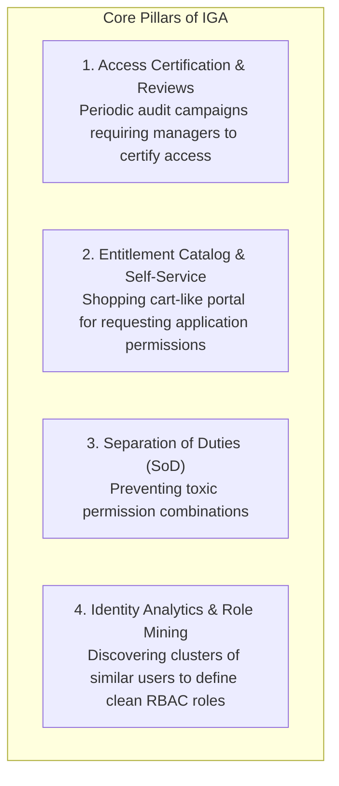

# 06. Identity Governance and Administration (IGA)

[⬅️ Prev: Privileged Access Management](./05_Privileged_Access_Management_PAM.md) | [Back to Core Concepts](./README.md) | [Next: Service Accounts & Machine Identities ➡️](./07_Service_Accounts_and_Machine_Identities.md)

---

### 1. Definition and Purpose

While Access Management (IdPs like Okta and Entra ID) handles real-time authentication and SSO tokens, **Identity Governance and Administration (IGA)** answers the higher-level questions of compliance, policy, and oversight:

- *Who has access to what across the entire enterprise?*
- *Who authorized that access, and when?*
- *Is this access still required for their current job?*
- *Are there conflicting entitlements that violate audit regulations (Separation of Duties)?*

IGA platforms (such as **SailPoint IdentityIQ / IdentityNow** and **Saviynt**) act as the centralized governance brain that orchestrates identity across heterogeneous clouds, on-premises Active Directory forests, legacy ERP systems (SAP), and databases.

---

### 2. Core IGA Functional Pillars

---

### 3. Separation of Duties (SoD) and Toxic Combinations

**Separation of Duties (SoD)** is an internal control concept designed to prevent fraud and critical errors by ensuring that no single individual has the authority to execute all steps of a sensitive transaction.

#### The Classic Financial SoD Violation:
- **Permission A**: Ability to create a new vendor in the accounts payable ledger.
- **Permission B**: Ability to approve wire transfers and pay invoices.
- **The Toxic Combination**: If Alice possesses both Permission A and Permission B, she can create a fictitious company belonging to herself and wire \$1,000,000 to her personal account without secondary oversight.

An enterprise IGA platform enforces **Automated Toxic Combination Checks**:
If a user with Permission A requests Permission B, the IGA engine automatically blocks the request and triggers a high-severity compliance alert to the Chief Risk Officer.

---

### 4. Access Certification Campaigns

Regulations such as Sarbanes-Oxley (SOX) Section 404 mandate that enterprises perform periodic (typically quarterly) **Access Certifications**:

1. **Campaign Launch**: IGA platform generates review tasks for all managers.
2. **Review Interface**: A manager sees a list of every employee on their team and every entitlement they possess.
3. **Action Required**: The manager must explicitly click **Approve** or **Revoke** for each line item.
4. **Automated Remediation**: If a manager clicks Revoke, the IGA platform automatically executes downstream deprovisioning tasks via SCIM or Active Directory connectors to strip the permission immediately.
5. **Audit Sign-off**: Evidence reports are archived with cryptographic timestamps for presentation to external auditors (e.g., PwC, Ernst & Young).
