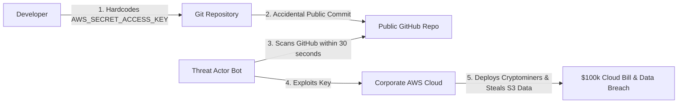

# 07. Service Accounts and Machine Identities

[⬅️ Prev: Identity Governance & Administration](./06_Identity_Governance_and_Administration_IGA.md) | [Back to Core Concepts](./README.md) | [Next: Technologies & Protocols Track ➡️](../03_Technologies_and_Protocols/README.md)

---

### 1. Definition and Explosion of Machine Identities

In enterprise computing, human users represent only a fraction of total identities. For every single human employee, there are often **10 to 45 non-human identities (NHIs)** operating in the background.

A **Machine Identity** (or Service Account) is an identity created for automated processes, background services, APIs, microservices, container workloads, and CI/CD pipelines to authenticate and interact with other systems.

Examples:
- An automated backup script running on a Linux server accessing an AWS S3 bucket.
- A Jenkins runner pulling code from GitHub Enterprise.
- A Kubernetes pod communicating with a managed Postgres database.
- An enterprise monitoring agent (Datadog) querying system metrics.

---

### 2. Machine Identities vs Human Identities

| Dimension | Human Identities | Machine Identities / Service Accounts |
| :--- | :--- | :--- |
| **Authentication Artifacts** | Passwords, FIDO2 WebAuthn keys, Face/Fingerprint biometrics, TOTP. | API tokens, X.509 private keys/certificates, OAuth client secrets, AWS IAM access keys. |
| **Interactive Login** | Yes. Logs into graphical user interfaces (web portals, desktop OS). | No. Headless execution via API, CLI, or background daemons. |
| **MFA Support** | Supported natively via human interaction. | Impossible to prompt for interactive MFA; requires certificate-based mutual TLS (mTLS) or workload federation. |
| **Lifecycle Driver** | Direct JML correlation with HR employment status. | Tied to software development projects, cloud deployments, and server lifecycles. Frequently forgotten! |
| **Primary Risk** | Phishing, credential reuse, social engineering. | **Secret Sprawl**: Hardcoded credentials committed to Git repositories or unrotated static API keys. |

---

### 3. The Threat: Unmanaged Service Accounts

---

### 4. Modern Enterprise Solutions for Machine Identities

1. **Eliminate Static Credentials using Workload Identity Federation**:
   - Instead of creating static AWS access keys for GitHub Actions, use **OIDC Federation**. The GitHub runner requests a short-lived token from GitHub, exchanges it with AWS STS for a temporary 15-minute IAM role session, and terminates. No long-lived secrets exist to be stolen!
2. **Managed Service Identities**:
   - Use Azure Managed Identities or AWS IAM Roles for EC2/ECS. The cloud infrastructure handles identity assignment and key rotation automatically beneath the operating system.
3. **Secrets Management Vaulting**:
   - Enforce tools like **HashiCorp Vault** or CyberArk Conjur. Applications fetch dynamic database credentials that expire automatically after 1 hour.
