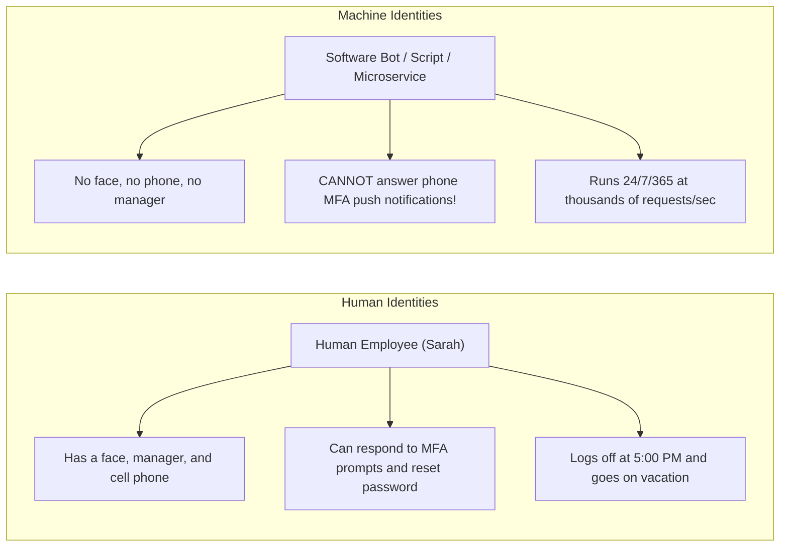
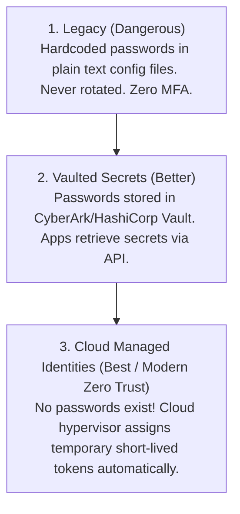
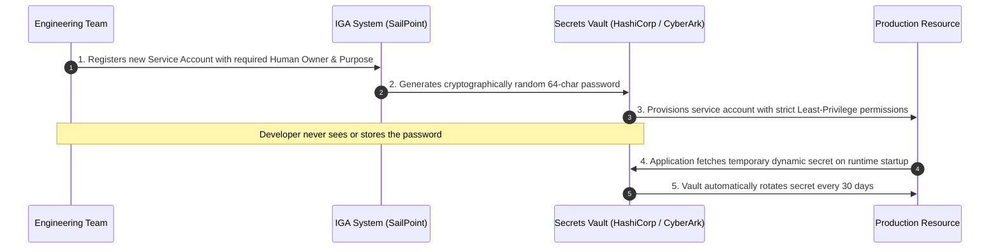

# 07. Service Accounts and Machine Identities

[⬅️ Prev: Identity Governance & Administration](./06_Identity_Governance_and_Administration_IGA.md) | [Back to Core Concepts](./README.md) | [Next: Technologies & Protocols Track ➡️](../03_Technologies_and_Protocols/README.md)

---

### 🎓 Beginner's Compass: Decoded Acronyms & Tools
- **Machine Identity (Non-Human Identity / NHI)**: An identity used by software, servers, applications, or scripts to talk to other software (e.g., a web application logging into a backend database).
- **Service Account**: A dedicated operating system or domain user account configured specifically for background automated tasks (e.g., `svc-sql-backup`).
- **Service Principal (SPN)**: An application identity registered in cloud directories (like Microsoft Entra ID or AWS IAM) representing software rather than a person.
- **Managed Identity**: A modern cloud security mechanism (in Azure/AWS/GCP) where the cloud provider manages the credentials automatically, so developers **never have to touch or hardcode passwords!**
- **Secret Sprawl**: The dangerous habit of developers leaving passwords, API keys, and private SSH keys hardcoded inside GitHub source code files.
- **HashiCorp Vault**: The premier enterprise secrets management tool that dishes out temporary, auto-expiring database credentials to software.

---

### 1. Plain-English Walkthrough: The Human vs. The Machine

#### The Fundamental Difference
In modern enterprises, **non-human identities outnumber human employees by 10 to 1!**

#### The Real-World Danger: The Hardcoded Password
A software developer builds an automated script to back up customer data every night at midnight.
- The script needs access to the main database.
- The developer creates a database account named `backup_admin` with password `Password123!`.
- The developer pastes that password directly into line 14 of their Python script and commits it to GitHub.
- **The Catastrophe**: A rogue contractor or dark web credential scraper finds the GitHub repository, copies the password, and downloads the entire customer database. Because the account was a "service account", it had no MFA and no manager doing quarterly reviews!

---

### 2. Evolution of Machine Identity Security

#### Modern Gold Standard: Cloud Managed Identities
In modern cloud architectures (e.g., Azure Managed Identities, AWS IAM Roles for Service Accounts / IRSA):
1. A virtual machine or container needs to read files from a secure cloud storage bucket.
2. The developer **writes zero passwords or API keys** in the application code.
3. When the application boots, it queries the local cloud metadata endpoint (`http://169.254.169.254`).
4. The cloud platform verifies: *"Yes, this application is running on Virtual Machine #5."*
5. The cloud platform issues an ephemeral JSON Web Token (JWT) valid for only 60 minutes.
6. The app accesses the storage bucket securely. Even if a hacker steals the VM disk, **there are no passwords to steal!**

---

### 3. Service Account Management Lifecycle

To secure machine identities across the enterprise:

---

### 4. Common Beginner Mistakes vs. Best Practices

| Common Beginner Mistake | Real-World Risk | Industry Best Practice |
| :--- | :--- | :--- |
| **Giving Service Accounts Domain Admin** | When an application fails, lazy admins grant `Domain Admin` to make it work. An attacker compromising that single web app gets total network control. | Enforce strict least-privilege. Grant only the exact database or file permissions required. |
| **Interactive Logins for Service Accounts** | Allowing a service account to log into an interactive Windows desktop allows hackers to use it as a backdoor. | Enforce the `Deny log on locally` and `Deny log on through Remote Desktop` Group Policy Objects (GPO) for all service accounts. |
| **Unowned (Orphan) Service Accounts** | When the engineer who wrote a script leaves the company, nobody knows what the service account does, so nobody dares delete it. | Mandate an active **Human Owner** for every service account in the IGA database. If the owner leaves without transferring ownership, trigger automatic escalation. |

---

### 5. Recommended Next Steps
Now that you have mastered the Core Concepts of IAM, dive into the foundational technologies, protocols, and directory standards that power enterprise identity:
- [03. Technologies & Protocols: Active Directory and LDAP ➡️](../03_Technologies_and_Protocols/01_Active_Directory_and_LDAP.md)
