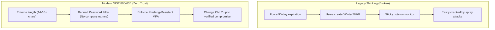
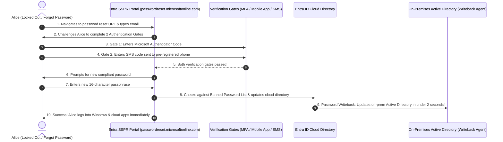
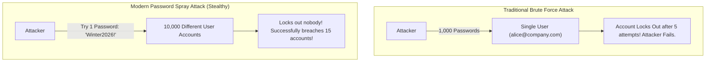

# 08. Password Policies, SSPR, and Credential Defense

[⬅️ Prev: Service Accounts & Machine Identities](./07_Service_Accounts_and_Machine_Identities.md) | [Back to Core Concepts](./README.md) | [Next: Technologies & Protocols Track ➡️](../03_Technologies_and_Protocols/README.md)

---

### 🎓 Beginner's Compass: Decoded Acronyms & Terms
- **SSPR (Self-Service Password Reset)**: A secure web workflow allowing employees to reset their forgotten passwords themselves without calling the IT helpdesk.
- **NIST SP 800-63B**: The United States National Institute of Standards and Technology official digital identity guidelines. It changed global rules on how passwords should be managed.
- **Password Spray Attack**: An automated attack where a hacker tries ONE common password (like `Winter2026!`) against 10,000 different user accounts to avoid triggering account lockouts.
- **Smart Lockout**: An intelligent cloud defense in Microsoft Entra ID that locks out hackers attempting brute-force attacks while still allowing the legitimate employee to log in from their trusted corporate laptop.
- **Banned Password List**: A dynamic database of millions of known breached, leaked, or easily guessable passwords blocked by the identity system.

---

### 1. Plain-English Walkthrough: The Death of Old Password Rules

For 25 years, corporate IT departments forced employees to obey rules that actually made security **worse**:
- *"Change your password every 90 days."*
- *"Include at least one uppercase letter, one lowercase letter, one number, and one symbol."*

#### Why Old Rules Failed:
When forced to change passwords every 90 days, human psychology takes over:
- Employees chose predictable patterns: `Spring2025!` became `Summer2025!`, which became `Fall2025!`.
- Employees wrote passwords on sticky notes stuck to their computer monitors.
- Hackers figured this out decades ago.

#### The Modern NIST 800-63B Standard (What You Need to Know):
1. **Stop Forced 90-Day Expirations**: Passwords should **only** be changed when there is evidence of a breach or compromise.
2. **Length Over Complexity**: A long passphrase of 4 random words (`correct-horse-battery-staple`, 28 characters) is exponentially harder for computers to crack than a short complex string (`P@ss1`, 5 characters).
3. **Screen Against Compromised Dictionaries**: Automatically reject any password that appears in dark web breach lists or contains the company's name.

---

### 2. SSPR (Self-Service Password Reset) Architecture

In large enterprises, **30% to 50% of all IT helpdesk calls are password resets**, costing organizations \$50 to \$70 per ticket! SSPR solves this by automating the recovery process.

> [!IMPORTANT]
> **Password Writeback** is a crucial feature for hybrid organizations. When an employee resets their password in cloud Entra ID, the on-premises Entra Connect agent writes that new password down into the local on-prem Active Directory instantly, ensuring Alice's Windows laptop accepts the new password immediately.

---

### 3. Password Spraying vs. Brute Force & Smart Lockout

Beginners must understand the difference between **Brute Force** and **Password Spraying**:

#### How Microsoft Entra Smart Lockout Protects Users:
Traditional Active Directory lockout counts failed attempts from anywhere. If an attacker in another country types the wrong password 5 times, **the real employee gets locked out of their work computer** (Denial of Service).
* **Smart Lockout**: Uses machine learning to evaluate the requesting IP address and familiar locations.
* If attempts come from an unfamiliar IP in an unusual location, Entra ID locks out the **attacker's IP address only**, while allowing Alice to continue working uninterrupted from her company laptop!

---

### 4. Common Beginner Mistakes vs. Best Practices

| Common Beginner Mistake | Real-World Risk | Industry Best Practice |
| :--- | :--- | :--- |
| **Keeping 90-Day Password Expiry** | Users create trivial incrementing passwords (`Company1!`, `Company2!`) that hackers easily predict. | Follow NIST 800-63B: eliminate mandatory periodic expiration; combine minimum 14-char length with strong MFA. |
| **SSPR Without 2 Verification Gates** | Allowing users to reset passwords with a single SMS code allows SIM-swappers to take over executive accounts. | Require **two independent gates** for SSPR (e.g., Authenticator App Push + Mobile Phone SMS / Security Question). |
| **No Password Writeback in Hybrid** | Resetting cloud passwords without writeback desynchronizes on-prem AD and cloud Entra ID, breaking workstation logins. | Enable **Password Writeback** in Microsoft Entra Connect Sync. |

---

### 5. Recommended Next Steps
Now that you have completed all core identity concepts, step into the technical protocols that power digital networks:
- [03. Technologies and Protocols Track ➡️](../03_Technologies_and_Protocols/README.md)
