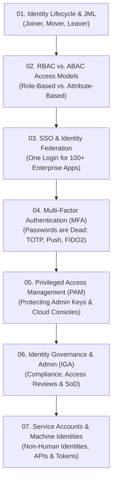

# 02. IAM Core Concepts Track

Welcome to the **IAM Core Concepts** module. Once you understand the fundamental definitions of identities, accounts, and Zero Trust, you must master the operational concepts and access architectures that govern how real organizations manage millions of digital transactions daily.

---

### 🗺️ Module Learning Pathway

---

### 📚 Topics in This Module

| Topic | Primary Focus | Everyday Analogy |
| :--- | :--- | :--- |
| [01. Identity Lifecycle and JML](./01_Identity_Lifecycle_and_JML.md) | How employee access changes from hiring to termination | The birth, promotions, and retirement of an employee badge |
| [02. RBAC vs. ABAC Access Models](./02_RBAC_vs_ABAC_Access_Models.md) | Assigning permissions via job titles vs contextual rules | Static job description vs Contextual bouncer rules |
| [03. Single Sign-On (SSO) and Federation](./03_Single_Sign_On_SSO_and_Federation.md) | Logging in once to access cloud SaaS and on-prem tools | Disney MagicBand / Master hotel key |
| [04. Multi-Factor Authentication (MFA)](./04_Multi_Factor_Authentication_MFA.md) | Something you know, something you have, something you are | Bank ATM card + PIN number + Hand biometric |
| [05. Privileged Access Management (PAM)](./05_Privileged_Access_Management_PAM.md) | Securing Domain Admins, root passwords, and cloud keys | The bank manager's vault and dual-custody safety deposit box |
| [06. Identity Governance & Administration (IGA)](./06_Identity_Governance_and_Administration_IGA.md) | Compliance audits, access certifications, and policy enforcement | The City Hall property deed records and annual property tax audit |
| [07. Service Accounts and Machine Identities](./07_Service_Accounts_and_Machine_Identities.md) | Securing APIs, automation scripts, bots, and workloads | Automated robotic delivery carts roaming warehouse floors |

---

### 🎓 How to Study This Module
1. Read the **Beginner's Compass** callout at the top of each document first to familiarize yourself with the acronyms and tools.
2. Review the **Plain-English Walkthrough** before tackling the architectural diagrams and technical specifications.
3. Pay close attention to **Common Mistakes vs. Best Practices**—these directly map to real-world interview and operational scenarios.
