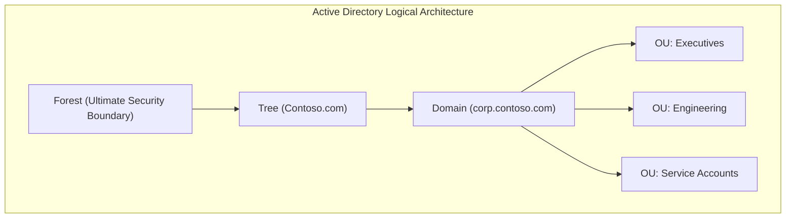

# 01. Active Directory and LDAP (Lightweight Directory Access Protocol)

[⬅️ Back to Technologies](./README.md) | [Next: Kerberos Authentication ➡️](./02_Kerberos_Authentication.md)

---

### 1. Definition and Purpose

**Active Directory Domain Services (AD DS)** is Microsoft's directory service system used by over 90% of Global Fortune 1000 organizations to centrally store, manage, and secure information about network resources, users, computers, printers, and groups.

**LDAP (Lightweight Directory Access Protocol)** is the open, vendor-neutral application protocol (RFC 4511) used to query, search, and modify directory items over an IP network.

> 💡 **Analogy**:
> - Think of **Active Directory** as a massive corporate phone book and organizational chart stored in a specialized, highly indexed database.
> - **LDAP** is the specialized language you use to speak to the phone operator: *"Operator, find me all employees whose department is 'Accounting' and who are located in the 'London' office."*

---

### 2. Architecture of Active Directory



- **Forest**: The highest level of authority and the ultimate security boundary in AD. Contains one or more domain trees sharing a common Schema, Configuration, and Global Catalog.
- **Domain**: An administrative partition of objects. Replicated across all Domain Controllers (DCs) within that domain.
- **Organizational Unit (OU)**: Logical containers within a domain used to organize users and computers for the delegation of administration and the application of **Group Policy Objects (GPOs)**.
- **Schema**: The blueprint definition of all object classes (User, Computer, Group) and attributes (sn, givenName, mail, sAMAccountName) permitted in the forest.

---

### 3. LDAP Mechanics and Network Ports

LDAP stores data in a hierarchical tree structure called the **Directory Information Tree (DIT)**. Objects are addressed by their **Distinguished Name (DN)**:
`CN=Alice Smith,OU=Engineering,OU=Users,DC=corp,DC=contoso,DC=com`

#### Important Network Ports:
| Protocol | Port | Security Posture |
| :--- | :--- | :--- |
| **LDAP (Cleartext)** | TCP 389 | ❌ **UNSECURE**: Passwords sent via simple bind are transmitted in plain text across the network. |
| **LDAPS (LDAP over SSL/TLS)** | TCP 636 | ✅ **SECURE**: Encrypted with TLS certificate. Industry mandatory standard. |
| **LDAP Global Catalog** | TCP 3268 (Plain) / 3269 (SSL) | Used to search across all domains in the entire AD forest. |

#### Enterprise LDAP Search Filter Syntax:
```ldap
# Find all active users in Finance with an email ending in @company.com
(&(objectCategory=person)(objectClass=user)(department=Finance)(mail=*@company.com)(!(userAccountControl:1.2.840.113556.1.4.803:=2)))
```
*(Note: `userAccountControl:1.2.840.113556.1.4.803:=2` checks the bitmask for disabled accounts; the `!` inverts it to match only active accounts).*

---

### 4. Common Security Misconfigurations

1. **Cleartext LDAP Binds**: Allowing third-party appliances (printers, VPNs) to authenticate using plaintext LDAP (Port 389). Any attacker running Wireshark on the LAN can sniff administrator credentials.
2. **Over-permissive OU Delegation**: Granting unprivileged users "Write" permissions on OUs or group objects, allowing privilege escalation to Domain Admin.
