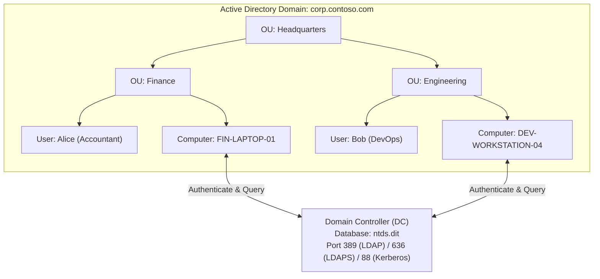
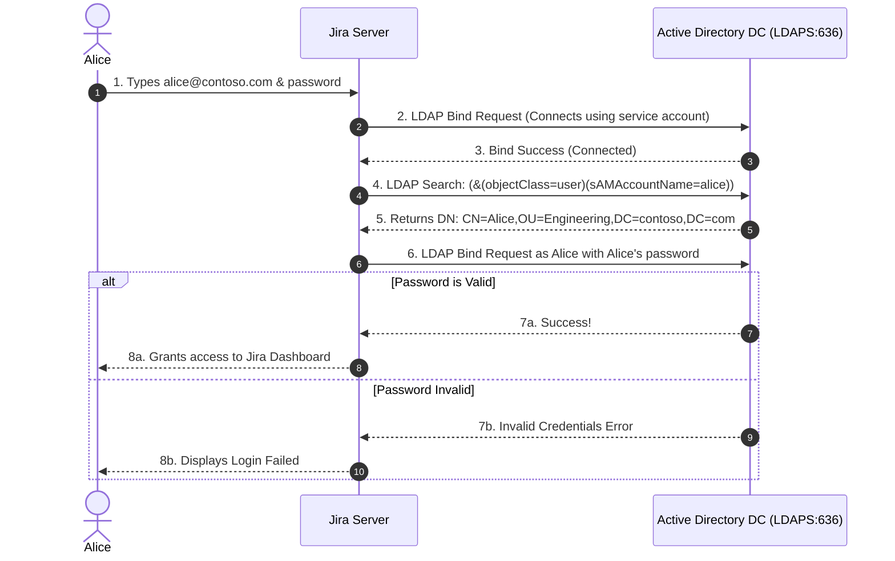

# 01. Active Directory and LDAP

[⬅️ Back to Protocols](./README.md) | [Next: Kerberos Authentication ➡️](./02_Kerberos_Authentication.md)

---

### 🎓 Beginner's Compass: Decoded Acronyms & Terms
- **AD DS (Active Directory Domain Services)**: Microsoft's directory service used by 90%+ of global enterprises to manage Windows computers, users, printers, and security groups.
- **LDAP (Lightweight Directory Access Protocol)**: The standard networking language used to search and read information from a directory database (e.g., *"Find the email address for user 'alice'"*).
- **Domain Controller (DC)**: The Windows Server holding the master copy of the Active Directory database. It answers logins and checks passwords.
- **OU (Organizational Unit)**: A folder inside Active Directory used to organize users and computers (e.g., `Finance`, `Engineering`, `Laptops`).
- **GPO (Group Policy Object)**: A set of automated configuration rules pushed to all company laptops (e.g., *"Disable USB flash drives"*, *"Lock screen after 5 minutes"*).
- **Distinguished Name (DN)**: The full unique address of an object in LDAP (e.g., `CN=Alice Smith,OU=Engineering,DC=corp,DC=company,DC=com`).

---

### 1. Plain-English Walkthrough: The Corporate Phonebook Analogy

#### What Problem Does Active Directory Solve?
Imagine an office with 1,000 employees and 1,000 Windows computers:
- Without Active Directory, every time Alice wants to log into a computer, an IT technician must walk over and manually create a local username and password on that specific machine!
- If Alice changes her password, she would have to change it on all 1,000 computers.
- If Alice is fired, IT would have to visit every computer in the building to delete her local account.

#### With Active Directory (Centralized Directory)
- All 1,000 computers are connected to a central **Domain Controller (DC)**.
- Alice's account exists in one place: the Active Directory database (`ntds.dit`).
- Alice can sit down at **any company computer**, type her username and password, and the computer asks the Domain Controller: *"Is this password correct?"* The DC verifies it and logs her in.
- If Alice is terminated, the administrator disables her account on the DC once, and she is instantly blocked from every computer and file server in the company.

---

### 2. What is LDAP and How Does it Work?

While Active Directory is the database software, **LDAP is the communication protocol** used to speak to that database.

#### The LDAP Hierarchy (Tree Structure)
LDAP organizes information like an upside-down tree:
- **DC (Domain Component)**: `DC=contoso,DC=com` (The company domain).
- **OU (Organizational Unit)**: `OU=HumanResources` (The department).
- **CN (Common Name)**: `CN=Sarah Connor` (The individual user).

#### Standard LDAP Ports Every IAM / SOC Analyst Must Know
| Protocol | Port | Security Level | Purpose |
| :--- | :--- | :--- | :--- |
| **LDAP** | **TCP 389** | **Insecure (Plaintext)** | Cleartext queries. Passwords sent across the wire can be intercepted by hackers using Wireshark! |
| **LDAPS** | **TCP 636** | **Secure (TLS Encrypted)** | Modern industry standard. Encrypts all directory queries with X.509 certificates. |
| **Global Catalog** | **TCP 3268 / 3269** | Multi-domain forest lookup | Used to search for users across multiple domains in a large enterprise forest. |

---

### 3. Step-by-Step LDAP Query Example

When an application (like Jira or Zoom) wants to authenticate a user via on-prem LDAP:

---

### 4. Common Beginner Mistakes vs. Best Practices

| Common Beginner Mistake | Real-World Risk | Industry Best Practice |
| :--- | :--- | :--- |
| **Using Cleartext LDAP (Port 389)** | Attackers sniffing corporate Wi-Fi or compromised switches can read user passwords in plaintext. | Block port 389 and mandate **LDAPS (Port 636)** with enforced channel binding and signing. |
| **Overusing Domain Admin Rights** | Adding helpdesk staff to the `Domain Admins` group so they can reset passwords. | Use Active Directory **Delegation of Control** to grant granular permissions (e.g., reset passwords on specific OUs only). |
| **Unprotected Default Administrator** | Leaving the built-in local `Administrator` account with the same default password across 5,000 laptops. | Deploy Microsoft **LAPS (Local Administrator Password Solution)** to randomize every laptop's local admin password. |

---

### 5. Recommended Next Steps
Now that you understand the directory database, discover how users prove their identity without sending passwords across the wire:
- [02. Kerberos Authentication Deep Dive ➡️](./02_Kerberos_Authentication.md)
